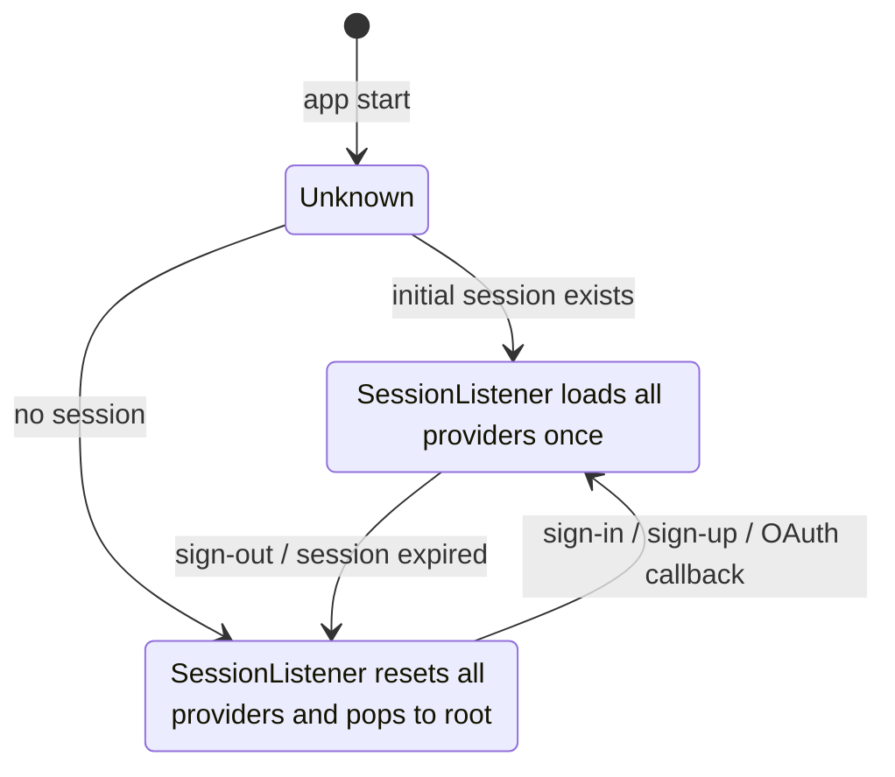

# Shams Mobile App: Clean Architecture Execution Plan

| Item | Value |
|---|---|
| Parent document | [clean-architecture-migration-plan.md](./clean-architecture-migration-plan.md) (architecture, conventions, file map) |
| This document | Step-by-step **execution** of the migration (replaces §7 of the parent document) |
| Status | Ready to execute. All decisions D1–D7 approved. |
| Toolchain | Flutter 3.47.1 (stable), Dart SDK `^3.10.0` |

---

## Table of Contents

1. [Approved Decisions](#1-approved-decisions)
2. [Working Agreement](#2-working-agreement)
3. [Verification Gates](#3-verification-gates)
4. [Cross-Phase Strategies](#4-cross-phase-strategies)
5. [Phase 0: Preparation](#phase-0-preparation)
6. [Phase 1: Core Foundation](#phase-1-core-foundation)
7. [Phase 2: Auth & Session Lifecycle](#phase-2-auth--session-lifecycle)
8. [Phase 3: Profile & Shared User Entity](#phase-3-profile--shared-user-entity)
9. [Phase 4: Posts](#phase-4-posts)
10. [Phase 5: Workshops](#phase-5-workshops)
11. [Phase 6: Chat & Maintenance](#phase-6-chat--maintenance)
12. [Phase 7: Notifications](#phase-7-notifications)
13. [Phase 8: Cleanup & Enforcement](#phase-8-cleanup--enforcement)
14. [Phase 9: Post-Migration Backlog](#phase-9-post-migration-backlog)
15. [Appendix A: Smoke-Test Checklist](#appendix-a-smoke-test-checklist)
16. [Appendix B: Progress Tracker](#appendix-b-progress-tracker)

---

## 1. Approved Decisions

| # | Decision | How it shows up in this plan |
|---|---|---|
| D1 | **`get_it` without codegen** | `core/di/injection.dart` (Phase 1). Each feature adds an `_init<Feature>()` function. |
| D2 | **Supabase session is the only source of truth for auth** | `LocalStorageService` and the `is_logged_in` / `user_email` keys are removed (Phase 2). `AuthGate` reacts to Supabase auth state. |
| D3 | **Custom sealed `Result<T>` (`Ok` / `Err`)** | `core/result/result.dart` (Phase 1). No `dartz` / `fpdart`. |
| D4 | **Domain uses `String path`, not `dart:io File`** | Use-case params carry paths. Only data sources create `File` or read bytes. `WorkshopData.profileImage: File?` is replaced (Phase 5). |
| D5 | **Shared user entity in `core/domain/entities/app_user.dart`** | Created in Phase 1, replaces `UserModel` everywhere in Phase 3. |
| D6 | **Fix K4, K6, K7 during the migration. K1, K2 after.** | K4 = errors shown to users (every feature phase). K6 + K7 = session lifecycle (Phase 2). K1 + K2 = [Phase 9](#phase-9-post-migration-backlog). |
| D7 | **Stay on `provider`** | Providers remain `ChangeNotifier`s. They receive use cases from `get_it`. |

---

## 2. Working Agreement

### 2.1 Branching

- Create each phase branch from `main`: `refactor/ca-p<N>-<name>`. Example: `refactor/ca-p4-posts`.
- Merge a phase into `main` only after it passes **Gate G2** ([§3](#3-verification-gates)). Every phase must leave the app shippable. There is no long-lived refactor branch.
- Don't develop features during an active phase. If a hotfix is required, land it on `main` and rebase the phase branch.

### 2.2 Commits

- One commit per numbered step (e.g. `P4.3`). Each commit must compile and pass **Gate G1**.
- Use the Conventional Commits format with the step ID:

  ```text
  refactor(posts): P4.3 add PostRemoteDataSource
  test(posts): P4.8 add FeedProvider tests
  fix(session): P2.9 reset all providers on sign-out (K7)
  ```

- Behavior changes (K-fixes, bugs) go in **separate commits** with the `fix:` prefix, so they're easy to review or revert.

### 2.3 Moving files

- Move files with the IDE (VS Code: drag in Explorer, or **F2** on a class name; Android Studio: **Refactor → Move**) so imports update automatically.
- Use `package:shams_mobile_app/...` imports in every new or moved file (`always_use_package_imports` is enabled in Phase 1).
- Keep the existing Arabic comments when moving code. Translate or remove them only if they become wrong.

### 2.4 Rollback

- Each phase is a single PR merge. To roll back, revert the merge commit.
- Within a phase, revert a single step with `git revert <step-commit>`. Steps are designed to be independent within their ordering.

---

## 3. Verification Gates

### G1: after every step (commit)

```powershell
flutter analyze                               # no NEW issues vs. baseline (docs/baseline/analyze.txt)
flutter test                                  # all green
dart run tool/check_architecture.dart         # available from P1.10
```

### G2: before merging a phase

1. G1 passes.
2. `flutter build apk --debug` succeeds.
3. Run the [Appendix A](#appendix-a-smoke-test-checklist) sections listed in the phase's "Smoke scope" on a **real device or emulator**, in both light and dark mode.
4. The phase's **Exit criteria** checklist is fully ticked.
5. Update the [Appendix B](#appendix-b-progress-tracker) tracker in the same PR.

---

## 4. Cross-Phase Strategies

### 4.1 Coexistence of old and new code

While the migration runs, legacy folders (`models/`, `providers/`, `services/`, `views/`, `widgets/`) live next to `core/`, `app/` and `features/`. Rules:

| Allowed temporarily | Not allowed |
|---|---|
| A migrated feature's **presentation** imports a **legacy provider** of a feature that isn't migrated yet (e.g. posts screens reading `WorkshopProvider` before Phase 5) | Any file under `features/` importing anything from legacy `services/` |
| Legacy code importing new `core/` or `features/*/domain` types | New code importing legacy `models/` (except during the step that replaces them) |
| A thin legacy shim delegating to a new data source (e.g. `StorageService` → `FileStorageDataSource`) | Adding new logic to a legacy file |

`tool/check_architecture.dart` enforces the right-hand column for `core/`, `app/` and `features/`. Legacy folders aren't checked, and they're deleted in Phase 8.

### 4.2 Type ownership (avoiding dual models)

Each shared type is replaced **everywhere** in the phase that owns it. This avoids converting between old and new versions of the same type.

| Type | Owner phase | Replaced in |
|---|---|---|
| `UserModel` → `AppUser` | Phase 3 | All 11 files that reference it (models, providers, chat screens, workshop profile) |
| `PostModel`, `CommentModel` → `Post`, `Comment` | Phase 4 | Feed, post detail, create/edit post, **and** `WorkshopProvider`'s post list + `PublicWorkshopModel.posts` |
| `PublicWorkshopModel`, `WorkshopData`, `ReviewModel` → `Workshop`, `MyWorkshop`, `Review` | Phase 5 | Workshops, dashboard, chat screens using `getWorkshopByOwnerId` |
| `ChatModel`, `MessageModel`, `MaintenanceRequestModel` → `Chat`, `Message`, `MaintenanceRequest` | Phase 6 | Chat + workshop profile (maintenance trigger) |
| `NotificationModel` → `AppNotification` | Phase 7 | Notifications |

### 4.3 Unused backend methods

Several service methods aren't called by any screen or provider:

| Service | Unused methods |
|---|---|
| `post_service.dart` | `savePost`, `unsavePost` (`deletePost` is unused too, see bug B1) |
| `chat_service.dart` | `fetchMessages` |
| `maintenance_service.dart` | `fetchMyRequests`, `fetchWorkshopRequests`, `updateStatus`, `deleteRequest` |
| `review_service.dart` | **all**: `addReview`, `fetchWorkshopReviews`, `updateReview`, `deleteReview` |
| `workshop_service.dart` | `fetchWorkshopById`, `deleteWorkshop` |
| `storage_service.dart` | `deleteImage` |

**Rule:** port them into the **data source and repository**, since that's cheap and keeps the capability. Don't create use cases or provider methods for them until a screen needs them (YAGNI). Mark each with `// Not used by UI yet.`

### 4.4 Behavior preservation vs. fixes

The migration must not change behavior, except for:

| ID | Change | Phase | Approved |
|---|---|---|---|
| K4 | Errors surfaced to the user (SnackBar / error state) instead of `debugPrint` only | 2–7 | ✅ D6 |
| K6 | Providers stop loading in constructors. Loading is driven by the session lifecycle (this also removes the current **double fetch**: constructors *and* `MainScreen.initState` both load) | 2 | ✅ D6 |
| K7 | Sign-out resets **all** providers. Today the drawer forgets `WorkshopProvider.clearWorkshopData()` | 2 | ✅ D6 |
| B1 | **Bug found during planning:** deleting a post from the workshop dashboard only removes it locally (`WorkshopProvider.deletePost`). `PostService.deletePost` is never called, so the post stays in the database and in the feed. | 4 | ⚠️ Needs confirmation. Planned as a separate `fix:` commit (P4.10). |
| Session | Users whose old `is_logged_in` flag is `true` but whose Supabase session expired will now see the Welcome screen (correct behavior under D2) | 2 | ✅ D2 |

---

## Phase 0: Preparation

| | |
|---|---|
| Branch | `refactor/ca-p0-prep` |
| Estimate | 0.5 day |
| Smoke scope | Full checklist (to record the baseline) |

### Steps

**P0.1 Clean working tree**
- Commit or discard the current local changes (`analysis_options.yaml`, `pubspec.lock`, the stray `q` file at the repo root).

**P0.2 Record the baseline**
- `flutter analyze > docs/baseline/analyze.txt`
- Take screenshots of the main screens in light and dark mode → `docs/baseline/screenshots/`
- Run the full [Appendix A](#appendix-a-smoke-test-checklist) and record results in `docs/baseline/smoke.md`. Note any items that **already fail**, so they aren't blamed on the migration later.

**P0.3 Add dependencies**

```powershell
flutter pub add get_it
flutter pub add dev:mocktail
```

**P0.4 Test scaffolding**
- `test/` exists but is empty. Create `test/helpers/` and add one sanity test (`test/sanity_test.dart`) so `flutter test` runs green in CI and locally.

**P0.5 Commit this plan**
- Add `docs/clean-architecture-migration-plan.md` and this file.

### Exit criteria

- [ ] Working tree is clean. Baseline files are committed.
- [ ] `get_it` and `mocktail` are in `pubspec.yaml`. The app runs unchanged.
- [ ] `flutter test` is green (sanity test).

---

## Phase 1: Core Foundation

| | |
|---|---|
| Branch | `refactor/ca-p1-core` |
| Estimate | 1.5–2 days |
| Smoke scope | A1 (startup), A12 (theme), plus quick navigation through all tabs |
| Depends on | Phase 0 |

### Steps

**P1.1 Error and result types**
- Create:
  - `lib/core/error/exceptions.dart`: `ServerException`, `AuthException` (named `AppAuthException` to avoid clashing with Supabase's `AuthException`), `CacheException`, `NotFoundException`.
  - `lib/core/error/failures.dart`: sealed `Failure` + `ServerFailure`, `NetworkFailure`, `AuthFailure`, `CacheFailure`, `NotFoundFailure`, `UnknownFailure` (see parent doc §5.2).
  - `lib/core/result/result.dart`: sealed `Result<T>`, `Ok<T>`, `Err<T>`, `fold`.
- Add `lib/core/error/error_mapper.dart` with one helper used by every repository:

  ```dart
  Future<Result<T>> guard<T>(Future<T> Function() body) async {
    try {
      return Ok(await body());
    } on AppAuthException catch (e) {
      return Err(AuthFailure(e.message));
    } on NotFoundException catch (e) {
      return Err(NotFoundFailure(e.message));
    } on ServerException catch (e) {
      return Err(ServerFailure(e.message));
    } on SocketException {
      return const Err(NetworkFailure());
    } catch (e, s) {
      debugPrintStack(label: e.toString(), stackTrace: s);
      return const Err(UnknownFailure());
    }
  }
  ```

  > `error_mapper.dart` lives in `core/` and may import `dart:io` / `foundation`. Domain code never imports it; only repository implementations do.

- Tests: `test/core/result/result_test.dart`, `test/core/error/error_mapper_test.dart`.

**P1.2 Use-case base and view status**
- `lib/core/usecase/usecase.dart`: `UseCase<T, P>`, `StreamUseCase<T, P>`, `NoParams`.
- `lib/core/presentation/view_status.dart`: `enum ViewStatus { initial, loading, success, failure }`.
- `lib/core/presentation/resettable.dart`: `abstract interface class Resettable { void reset(); }`. Used by the session lifecycle in Phase 2.

**P1.3 Environment configuration**
- Create `lib/core/config/env.dart`:

  ```dart
  class Env {
    static const supabaseUrl = String.fromEnvironment('SUPABASE_URL');
    static const supabaseAnonKey = String.fromEnvironment('SUPABASE_ANON_KEY');
    static const oauthRedirectUrl = String.fromEnvironment(
      'OAUTH_REDIRECT_URL',
      defaultValue: 'shams://login-callback/',
    );

    static void validate() {
      if (supabaseUrl.isEmpty || supabaseAnonKey.isEmpty) {
        throw StateError(
          'Missing SUPABASE_URL / SUPABASE_ANON_KEY. '
          'Run with --dart-define-from-file=env/dev.json',
        );
      }
    }
  }
  ```

- Create `env/dev.json` with the current values from `main.dart` (git-ignored) and commit `env/example.json` with placeholders.
- Add `env/*.json` and `!env/example.json` to `.gitignore`.
- Add a VS Code launch config `.vscode/launch.json` with `"args": ["--dart-define-from-file=env/dev.json"]`.
- Document the run command in `README.md`.

**P1.4 Dependency injection skeleton**
- Create `lib/core/di/injection.dart`:

  ```dart
  final sl = GetIt.instance;

  Future<void> initDependencies() async {
    sl.registerLazySingleton<SupabaseClient>(() => Supabase.instance.client);
    sl.registerSingleton<SharedPreferences>(await SharedPreferences.getInstance());
    _initCore();
    // Feature registrations are added phase by phase:
    // _initAuth(); _initProfile(); _initPosts(); ...
  }

  void _initCore() {
    sl.registerLazySingleton<FileStorageDataSource>(
      () => FileStorageDataSourceImpl(sl()),
    );
    sl.registerLazySingleton<ThemeStorage>(() => ThemeStorage(sl()));
  }
  ```

- Tests: none (wiring). Verified by the app starting.

**P1.5 Split `main.dart` into `app/`**
- `lib/main.dart` becomes bootstrap only (target: under 30 lines):

  ```dart
  Future<void> main() async {
    WidgetsFlutterBinding.ensureInitialized();
    await SystemChrome.setPreferredOrientations([
      DeviceOrientation.portraitUp,
      DeviceOrientation.portraitDown,
    ]);
    Env.validate();
    await Supabase.initialize(url: Env.supabaseUrl, anonKey: Env.supabaseAnonKey);
    await initDependencies();
    final themeProvider = ThemeProvider(sl())..loadSavedTheme();
    runApp(AppProviders(themeProvider: themeProvider, child: const ShamsApp()));
  }
  ```

  > The current `try/catch` that "continues in offline mode" around `Supabase.initialize` is kept, but it must log through `debugPrint` and still call `initDependencies()`.

- `lib/app/app.dart`: `ShamsApp` (MaterialApp, theme, locale, RTL). Add `navigatorKey` (`lib/app/navigation.dart`: `final rootNavigatorKey = GlobalKey<NavigatorState>();`) for Phase 2.
- `lib/app/app_providers.dart`: the `MultiProvider` list.
- **Remove** the `ChangeNotifierProxyProvider<WorkshopProvider, FeedProvider>` and register `FeedProvider` with a plain `ChangeNotifierProvider`. Delete `FeedProvider.initializeFromWorkshops()` (F9, it's empty).
- Move `lib/views/main_screen.dart` → `lib/app/main_screen.dart` and `lib/widgets/auth_gate.dart` → `lib/app/auth_gate.dart` (content unchanged for now).

**P1.6 Theme and constants**
- `utils/theme.dart` → `lib/core/theme/shams_theme.dart`.
- Split `utils/constants.dart`:
  - `ShamsColors`, `ShamsExtendedColors` → `lib/core/theme/shams_colors.dart`
  - `ShamsConstants` (cities, service types, inverter brands, battery types) → `lib/core/constants/app_constants.dart`
- `providers/theme_provider.dart` → `lib/core/theme/theme_provider.dart`:
  - Create `lib/core/theme/theme_storage.dart` (wraps the injected `SharedPreferences`, key `shams_theme_mode` **unchanged** so users keep their preference).
  - `ThemeProvider(ThemeStorage storage)`. Remove `SharedPreferences.getInstance()` calls.
- Tests: `theme_provider_test.dart` (load / toggle / set with a mocked `ThemeStorage`).

**P1.7 File storage data source**
- Create `lib/core/data/datasources/file_storage_data_source.dart`:

  ```dart
  abstract interface class FileStorageDataSource {
    Future<String> uploadFile({required String bucket, required String path, required String localFilePath});
    Future<String> uploadBytes({required String bucket, required String path, required Uint8List bytes});
    Future<void> delete({required String bucket, required String path}); // Not used by UI yet.
  }
  ```

  - `uploadFile` reproduces `StorageService.uploadImage` (`upload` + `FileOptions(cacheControl: '3600', upsert: true)` + `getPublicUrl`).
  - `uploadBytes` reproduces the avatar uploads in `signup_profile_screen.dart` / `edit_profile_screen.dart` (`uploadBinary`). Those screens read bytes on purpose ("avoid SocketExceptions"), so keep that.
  - Wrap `StorageException` → `ServerException`.
- Turn `services/storage_service.dart` into a **temporary shim** that delegates to `sl<FileStorageDataSource>()`, so `PostService` and `workshop_dashboard_screen.dart` keep working. It gets deleted in Phase 5.

**P1.8 Shared user entity (definition only)**
- `lib/core/domain/entities/app_user.dart`: `AppUser` with **exactly** the fields of the current `UserModel`: `id, name, email, profileImageUrl, bio, phone, username, location, isVerified, hasWorkshop`, plus `copyWith`.
- `lib/core/data/models/app_user_model.dart`: `AppUserModel.fromJson(Map) → AppUser` (same defaults as `UserModel.fromMap`), `toJson(AppUser)`.
- Tests: mapping with full, partial and null fields.
- `UserModel` itself is **not** replaced yet (Phase 3, see [§4.2](#42-type-ownership-avoiding-dual-models)).

**P1.9 Formatters (for F6, used from Phase 4)**
- `lib/core/utils/formatters.dart`:
  - `formatRelativeTime(DateTime)`: must produce **exactly** the strings currently shown. Copy the existing logic from `PostModel.fromSupabase` / the models that use `timeago` (check `post_model.dart`, `comment_model.dart`, `notification_model.dart`, `message_model.dart`).
  - `formatCompactNumber(int)`: e.g. `45800 → "45.8K"`. Copy the existing formatting logic.
- Tests: table-driven tests comparing old and new output.

**P1.10 Shared widgets and the architecture check**
- Move these to `lib/core/widgets/`: `appbar.dart`, `primary_button.dart`, `outlined_button.dart`, `text_field.dart`, `search_bar.dart`, `inline_search_bar.dart`, `image_source_sheet.dart`, `scrollable_image_picker.dart`, `city_filter.dart`, `shams_bottom_nav_bar.dart`.
- **Exception:** `shams_drawer.dart` stays in `widgets/` until Phase 2 because it calls Supabase directly. It moves to `core/widgets/` in P2.10.
- Add `tool/check_architecture.dart` (parent doc §10.1) with these adjustments:
  - Checked roots: `lib/core/`, `lib/app/`, `lib/features/`.
  - `lib/core/di/injection.dart` is exempt from the "core must not import features" rule.
  - `lib/app/` must not import `supabase_flutter`, `shared_preferences`, legacy `services/`, or any `features/*/data/`.
  - `lib/features/**` must not import legacy `services/`.
- Update `analysis_options.yaml`: add `always_use_package_imports`, `avoid_print`.
  - `avoid_print` will flag `post_service.dart`. That's fixed when the file is replaced in Phase 4; until then, add `// ignore: avoid_print` there.

### Exit criteria

- [x] `main.dart` is bootstrap only. The Supabase URL/key are no longer in source code.
- [x] `core/` has error, result, usecase, config, di, theme, constants, data, domain, utils, widgets, presentation.
- [x] The proxy provider and `initializeFromWorkshops` are removed.
- [x] `dart run tool/check_architecture.dart` passes.
- [x] The theme preference survives the upgrade (same key).
- [x] Tests: result, error mapper, theme provider, `AppUserModel`, formatters.

---

## Phase 2: Auth & Session Lifecycle

| | |
|---|---|
| Branch | `refactor/ca-p2-auth` |
| Estimate | 2 days |
| Smoke scope | A1, A2, A3, A13 + quick pass over A4/A8/A10 to confirm data loads once after login |
| Depends on | Phase 1 |
| Fixes | F1 (auth part), F8, K4 (auth), K6, K7 |

### Target behavior



### Steps

**P2.1 Domain**
- `lib/features/auth/domain/entities/auth_user.dart`:

  ```dart
  class AuthUser {
    final String id;
    final String? email;
    final String? displayName; // userMetadata['full_name'] ?? userMetadata['name']
    const AuthUser({required this.id, this.email, this.displayName});
  }
  ```

- `lib/features/auth/domain/repositories/auth_repository.dart`:

  ```dart
  abstract interface class AuthRepository {
    AuthUser? get currentUser;
    Stream<AuthUser?> authStateChanges();   // emits the initial session first
    Future<Result<void>> signInWithEmail({required String email, required String password});
    Future<Result<void>> signInWithGoogle();
    Future<Result<AuthUser>> signUp({required String email, required String password, required String fullName});
    Future<Result<void>> signOut();
  }
  ```

- Use cases (`lib/features/auth/domain/usecases/`):
  - `SignInWithEmailUseCase`: validates empty fields (same rules and messages as `signin.dart`), then calls the repository.
  - `SignInWithGoogleUseCase`
  - `SignOutUseCase`
  - `WatchAuthStateUseCase` (`StreamUseCase<AuthUser?, NoParams>`)
  - `GetCurrentAuthUserUseCase`
  - `CompleteSignUpUseCase`: see P2.3.

**P2.2 Minimal profile domain (needed for sign-up)**
- `lib/features/profile/domain/repositories/profile_repository.dart` with **only** what sign-up needs. Phase 3 extends it.

  ```dart
  abstract interface class ProfileRepository {
    Future<Result<String>> uploadAvatar({required String userId, required String localFilePath});
    Future<Result<void>> upsertProfile(ProfileUpsert data);
  }
  ```

- `ProfileUpsert` (domain value object): `id, name, username, location, email, phone?, bio?, profileImageUrl?`.

**P2.3 `CompleteSignUpUseCase`**
- Reproduces the flow in `signup_profile_screen.dart`, with the same partial-failure semantics:
  1. `auth.signUp(email, password, fullName)`. **Fatal** on failure → `Err(AuthFailure)`.
  2. If an avatar path was given → `profiles.uploadAvatar`. **Non-fatal**: record a warning `'حدث خطأ أثناء رفع الصورة'` and continue.
  3. `profiles.upsertProfile(...)`. Only include `phone` / `bio` when non-empty and `profileImageUrl` when the upload succeeded. **Non-fatal**: record a warning `'حدث خطأ أثناء تحديث بيانات الملف'`.
  4. Return `Ok(SignUpOutcome(user, warnings: [...]))`.
- Tests: success; signUp fails; avatar fails but profile succeeds; profile fails; no avatar.

**P2.4 Data**
- `lib/features/auth/data/datasources/auth_remote_data_source.dart` (`SupabaseClient.auth`):
  - `signInWithPassword`, `signInWithOAuth(OAuthProvider.google, redirectTo: Env.oauthRedirectUrl)`, `signUp(email, password, data: {'full_name': fullName})`, `signOut`, `currentUser`, `onAuthStateChange`.
  - Map Supabase `AuthException` → `AppAuthException` with the **existing Arabic messages**:
    - `'Invalid login credentials'` → `'البريد الإلكتروني أو كلمة المرور غير صحيحة'`
    - `'Email not confirmed'` → `'يرجى تأكيد بريدك الإلكتروني أولاً'`
    - Port the sign-up messages from the `on AuthException` block in `signup_profile_screen.dart` (~L160).
- `lib/features/auth/data/datasources/auth_local_data_source.dart`: **only** `clearLegacyKeys()`, which removes `is_logged_in` and `user_email` (D2 cleanup).
- `lib/features/auth/data/repositories/auth_repository_impl.dart`: uses `guard()`. Maps Supabase `User` → `AuthUser`. `authStateChanges()` maps `onAuthStateChange` to `AuthUser?` and uses `distinct` on the user ID.
- `lib/features/profile/data/datasources/profile_remote_data_source.dart` (minimal): `uploadAvatar` (via `FileStorageDataSource.uploadBytes`, bucket `avatars`, file name `'$userId-${millis}.$ext'`, identical to today) and `upsertProfile` (`profiles.upsert`).
- `lib/features/profile/data/repositories/profile_repository_impl.dart` (minimal).
- Register `_initAuth()` and `_initProfile()` in DI.
- Call `sl<AuthLocalDataSource>().clearLegacyKeys()` once in `main.dart` after `initDependencies()`.
- Tests: `auth_repository_impl_test.dart` (exception mapping, user mapping), `profile_repository_impl_test.dart`.

**P2.5 `AuthProvider`**
- `lib/features/auth/presentation/providers/auth_provider.dart`:

  ```dart
  enum AuthStatus { unknown, authenticated, unauthenticated }

  class AuthProvider extends ChangeNotifier {
    AuthProvider(this._watch, this._signIn, this._google, this._signUp, this._signOut);
    AuthStatus status = AuthStatus.unknown;
    AuthUser? user;
    ViewStatus actionStatus = ViewStatus.initial; // drives button spinners
    String? errorMessage;
    List<String> warnings = const [];             // non-fatal sign-up warnings
    void start();                                 // subscribes to WatchAuthStateUseCase
    Future<bool> signInWithEmail(String email, String password);
    Future<void> signInWithGoogle();
    Future<bool> completeSignUp(SignUpParams params);
    Future<void> signOut();
  }
  ```

- **Multi-step guard:** while `completeSignUp` runs, stream events are **buffered**, and `status` only changes after the flow finishes. Otherwise the session listener would navigate away mid-sign-up, before the avatar and profile are saved. This replaces the current reliance on widget `mounted` checks.
- Register in `app_providers.dart` as the **first** provider: `ChangeNotifierProvider(create: (_) => sl<AuthProvider>()..start())`.
- Tests: status transitions from a fake stream, buffering during sign-up, error message on failure, `actionStatus` transitions.

**P2.6 Reactive `AuthGate`**
- `lib/app/auth_gate.dart`:

  ```dart
  return switch (context.watch<AuthProvider>().status) {
    AuthStatus.unknown => const _SplashLoader(),      // same white scaffold + spinner as today
    AuthStatus.authenticated => const MainScreen(),
    AuthStatus.unauthenticated => const WelcomeScreen(),
  };
  ```

- Remove the `LocalStorageService.isLoggedIn()` `FutureBuilder`.

**P2.7 `SessionListener` (fixes K6 + K7)**
- `lib/app/session_listener.dart`: a widget placed in `MaterialApp.builder` that listens to `AuthProvider.status` transitions.
  - **→ authenticated:**
    1. `rootNavigatorKey.currentState?.popUntil((r) => r.isFirst)`. This replaces the `pushAndRemoveUntil(AuthGate)` calls in `signin.dart`, `signup.dart` and `signup_profile_screen.dart`, and handles the OAuth callback.
    2. Run the load sequence moved from `MainScreen.initState`:
       ```text
       await UserProvider.fetchUserData()
       then in parallel: WorkshopProvider.fetchPublicWorkshops(), NotificationProvider.fetchNotifications(),
                         ChatProvider.fetchChats(), FeedProvider.fetchFeed()
       if user.hasWorkshop: await WorkshopProvider.fetchMyWorkshop(user.id, user.username ?? 'owner')
       ```
  - **→ unauthenticated:** call `reset()` on every provider that implements `Resettable`, then `popUntil(isFirst)`.
- Make the legacy providers implement `Resettable` by delegating to their existing clear methods: `UserProvider.clearUserData`, `NotificationProvider.clearNotifications`, `ChatProvider.clearChats`, `FeedProvider.clearFeed`, `WorkshopProvider.clearWorkshopData`. Also make sure each `reset()` unsubscribes realtime channels (chat and notifications).
- `SessionListener` gets the list of resettables from `context` (e.g. `[context.read<UserProvider>(), ...]`). Later phases update this list when providers are renamed or split.

**P2.8 Remove constructor loading (K6)**
- Delete the `fetch...()` calls from the constructors of `FeedProvider` (L14), `ChatProvider` (L22), `NotificationProvider` (L15), `WorkshopProvider` (L21).
- Delete the load block from `MainScreen.initState` (now in `SessionListener`).
- `workshop_dashboard_screen.dart` still calls `fetchMyWorkshop` / `fetchMyWorkshopPosts` for its own refresh. Keep those calls.

**P2.9 Migrate auth screens**
- Move to `lib/features/auth/presentation/screens/`: `welcome.dart`, `signin.dart`, `signup.dart`, `signup_profile_screen.dart`. Move `widgets/username_field.dart` → `lib/features/auth/presentation/widgets/`.
- In each screen:
  - Remove `supabase_flutter`, `LocalStorageService`, the `StreamSubscription<AuthState>` + `onAuthStateChange` listeners, and the manual `fetchUserData()` + `pushAndRemoveUntil(AuthGate)` calls.
  - Call `AuthProvider` methods. Show `errorMessage` / `warnings` in the **same SnackBar style** used today (K4).
  - Keep local form validation (empty fields) in the screen, or move it into `SignInWithEmailUseCase` if it's duplicated. Error text must stay the same.
  - `signup_profile_screen.dart`: pass the picked image as `String path` (D4).

**P2.10 Single sign-out path (K7)**
- `widgets/shams_drawer.dart` (~L223–227) and `views/user_profile/user_profile_screen.dart` (~L830–838): replace the manual `clear…()` calls + `LocalStorageService.clearLoginData()` + `Supabase…signOut()` + navigation with `await context.read<AuthProvider>().signOut();`. The `SessionListener` does the rest.
- Move `shams_drawer.dart` → `lib/core/widgets/shams_drawer.dart`.
  - The drawer reads `AuthProvider` (a feature provider) from `core/`. To keep `core` free of feature imports, inject sign-out as a callback: `ShamsDrawer({required VoidCallback onSignOut})`. Screens pass `() => context.read<AuthProvider>().signOut()`.

**P2.11 Delete legacy**
- Delete `lib/services/local_storage_service.dart` and `lib/services/supabase_service.dart` (unused after this phase; confirm with a search first).

### Exit criteria

- [ ] No file in `features/auth/`, `app/` or `core/widgets/` imports `supabase_flutter` or `shared_preferences`.
- [ ] `LocalStorageService` is deleted. Legacy keys are cleared on startup.
- [ ] There is exactly **one** sign-out code path. After sign-out, every provider is empty (verify by signing in as a second account: no data from the first account appears).
- [ ] After login, each provider fetches **once** (check the debug log or put breakpoints in the `fetch…` methods).
- [ ] Google OAuth returns to `MainScreen` from both SignIn and SignUp screens.
- [ ] Sign-up with avatar + profile data works. Partial failures show warnings.
- [ ] Tests: auth use cases (incl. `CompleteSignUpUseCase`), auth repository, `AuthProvider`.

---

## Phase 3: Profile & Shared User Entity

| | |
|---|---|
| Branch | `refactor/ca-p3-profile` |
| Estimate | 1–1.5 days |
| Smoke scope | A2 (profile data after login), A3, A11, A13 |
| Depends on | Phase 2 |

### Steps

**P3.1 Extend the profile domain**
- Add to `ProfileRepository`:

  ```dart
  Future<Result<AppUser?>> getProfile(String userId);          // null when the row doesn't exist
  Future<Result<void>> createDefaultProfile(DefaultProfile data);
  Future<Result<void>> updateProfile(String userId, ProfileUpdate data);
  ```

- `GetMyProfileUseCase(AuthRepository, ProfileRepository)` moves the rules out of `UserProvider.fetchUserData`:
  1. `auth.currentUser` is null → `Err(AuthFailure)`.
  2. `getProfile(id)`. If it returns `null`, create a default row:
     - `username` = email prefix before `@`, otherwise `'user_${id.substring(0, 5)}'`
     - `name` = `authUser.displayName ?? 'مستخدم شمس'`
     - `hasWorkshop = false`
     - Then fetch again.
  3. Override `email` with the auth email when it's present (the session is the source of truth for email).
- `UpdateProfileUseCase(params: name, username, phone, bio, location, newAvatarPath?)`: upload the avatar first (fatal on failure, same as `edit_profile_screen.dart`), then update the row, and return the updated `AppUser`.
- Tests: all branches above (existing row, missing row + email, missing row without email, displayName fallback, email override).

**P3.2 Data**
- Extend `ProfileRemoteDataSource`: `getProfile` (`.maybeSingle()`), `createDefaultProfile` (`upsert`), `updateProfile` (`update().eq('id', …)`).
- Tests for the repository.

**P3.3 Replace `UserModel` with `AppUser` everywhere (type ownership, §4.2)**
- Files to update: `chat_model.dart`, `comment_model.dart`, `post_model.dart`, `public_workshop_model.dart`, `review_model.dart`, `user_provider.dart`, `chat_provider.dart`, `chat_conversation_screen.dart`, `chat_list_screen.dart`, `workshop_profile_screen.dart`.
- Legacy models that call `UserModel.fromMap(...)` call `AppUserModel.fromJson(...)` instead. Nested `toMap()` calls (`chat_model.dart` L34–35, `comment_model.dart` L46, `post_model.dart` L100/L103, `review_model.dart` L50) use `AppUserModel.toJson(...)`. Check whether those `toMap()` methods are used at all, and delete them if not.
- Delete `lib/models/user_model.dart`.

**P3.4 `ProfileProvider`**
- Rename `UserProvider` → `ProfileProvider` (IDE rename) and move it to `lib/features/profile/presentation/providers/profile_provider.dart`.
- Constructor: `ProfileProvider(GetMyProfileUseCase, UpdateProfileUseCase)`.
- State: `AppUser? currentUser` (nullable instead of the `'جاري التحميل...'` placeholder) + `ViewStatus status` + `errorMessage`.
  - **Compatibility:** many widgets read `currentUser.name` etc. To avoid touching every screen at once, keep a non-null getter `AppUser get currentUserOrPlaceholder` that returns the old placeholder values, and migrate screens to the nullable version gradually.
- Methods: `load()` (was `fetchUserData`), `updateProfile(...)`, `updateWorkshopStatus(bool)` (unchanged), `reset()` (was `clearUserData`, implements `Resettable`).
- Keep the `_evictImage` image-cache logic here (UI concern).
- Update `SessionListener` and every `context.read/watch<UserProvider>()` call.

**P3.5 Migrate profile screens**
- Move to `lib/features/profile/presentation/screens/`: `user_profile_screen.dart`, `edit_profile_screen.dart`, `privacy_security_screen.dart`, `about_shams_screen.dart`.
- `edit_profile_screen.dart`: remove every `Supabase.instance.client` call (~L100–167) and use `ProfileProvider.updateProfile(...)`. Keep the current SnackBar texts (`'فشل رفع الصورة: …'`, success message). Pass the image as `String path`.
  - Drop the "no session → use the local path" dev fallback (~L121–124), since a session always exists under D2. Note this in the PR.
- `user_profile_screen.dart` (1007 LOC): only remove backend calls and update imports in this phase. Splitting it into widgets is optional here and recommended in Phase 8.

### Exit criteria

- [ ] `UserModel` no longer exists. `AppUser` is used everywhere.
- [ ] `ProfileProvider` has no Supabase import. Default-profile creation works for a fresh Google account.
- [ ] Editing a profile (with and without a new photo) works, and the new avatar shows immediately (cache eviction).
- [ ] Tests: `GetMyProfileUseCase`, `UpdateProfileUseCase`, profile repository, `ProfileProvider`.

---

## Phase 4: Posts

| | |
|---|---|
| Branch | `refactor/ca-p4-posts` |
| Estimate | 2.5–3 days |
| Smoke scope | A4, A5, A6, A7 (posts part of workshop profile & dashboard) |
| Depends on | Phase 3 |
| Fixes | F5, F6 (posts), K4 (posts), B1 (if confirmed) |

### Steps

**P4.1 Domain entities**
- `lib/features/posts/domain/entities/post.dart`: fields as in parent doc §8.1. `createdAt: DateTime`, `viewsCount: int`, `author: AppUser?`, `comments: List<Comment>`.
  - Drop `isLocalFile`. Check its usages first: it was used for dummy/local images. Image widgets decide between network and asset by URL prefix instead (`http` → network, else asset).
- `lib/features/posts/domain/entities/comment.dart`: mirror the fields of `CommentModel`, with `createdAt: DateTime`.

**P4.2 Repository contract + use cases**

| Use case | Wraps | Notes |
|---|---|---|
| `GetFeedUseCase` | `fetchFeed` + `fetchLikedPostIds` + `fetchComments` | Needs `currentUser` from `AuthRepository`. Comments are still fetched per post for now (**K1 deferred**). |
| `GetWorkshopPostsUseCase` | `fetchWorkshopPosts` + `fetchComments` | Used by the workshop dashboard and workshop profile |
| `CreatePostUseCase` | `createPost` | Params: `workshopId, textDetails, imagePaths: List<String>, isHighlighted` (D4) |
| `UpdatePostUseCase` | `updatePost` | |
| `DeletePostUseCase` | `deletePost` | Wired to the dashboard in P4.10 (B1) |
| `HidePostUseCase` | `hidePost` | |
| `TogglePostLikeUseCase` | `toggleLike` | Returns the new `isLiked` |
| `AddCommentUseCase` | `addComment` | Returns `Comment` |
| `DeleteCommentUseCase` | `deleteComment` | |
| `ToggleCommentLikeUseCase` | `toggleCommentLike` | |

- `savePost` / `unsavePost`: repository only ([§4.3](#43-unused-backend-methods)).
- Tests: one per use case (success + failure). For `GetFeed`, also test "no user → `AuthFailure`".

**P4.3 Data source**
- `lib/features/posts/data/datasources/post_remote_data_source.dart`: port **every** method of `post_service.dart` into an instance class `PostRemoteDataSourceImpl(SupabaseClient, FileStorageDataSource)`.
  - Keep the select strings (`profiles!posts_author_id_fkey(...)`, `workshops!posts_workshop_id_fkey(...)`) **byte-for-byte**.
  - `createPost`: upload loop via `FileStorageDataSource.uploadFile(bucket: 'posts', path: '$userId/${timestamp}_$i.jpg', localFilePath: …)`.
  - Keep the client-side notification side effect `_createLikeNotification` as a private method (behavior preservation; moving it to DB triggers is in Phase 9).
  - `_incrementPostsViews`: port as-is (**K2 deferred**). Replace `print` with `debugPrint`.
  - Catch `PostgrestException` → `ServerException`.
  - `userId` comes from `_db.auth.currentUser!.id` inside the data source, as today. This is acceptable in the data layer.

**P4.4 Data model + repository**
- `lib/features/posts/data/models/post_model.dart` (new, data layer): `PostModel.fromJson(json, {isLiked, comments}) → Post`. Parse `created_at` with `DateTime.parse(...).toLocal()`, `views_count` as `int`.
- `lib/features/posts/data/models/comment_model.dart`: `CommentModel.fromJson → Comment`.
- `PostRepositoryImpl` uses `guard()`, merges liked IDs, and filters hidden posts (already done in the data source).
- Tests: model mapping (incl. missing `profiles`, missing `workshops`, null images), repository mapping + error paths.

**P4.5 `FeedProvider`**
- Move it to `lib/features/posts/presentation/providers/feed_provider.dart`.
- Inject the use cases. Remove the `supabase_flutter` and `PostService` imports.
- Keep the public API used by widgets: `posts`, `getPostById`, `toggleLike`, `addComment`, `deleteComment`, `toggleCommentLike`, `addPost`, `updatePost`, `deletePost`, `hidePost`.
- Rename `fetchFeed` → `load` and `clearFeed` → `reset` (`Resettable`). Update `SessionListener`.
- Add `status` + `errorMessage`. Keep the optimistic like/comment-like with revert, and set `errorMessage` on revert (K4).
- Tests: load success/failure, optimistic like + revert, add/delete comment, hide.

**P4.6 `WorkshopProvider` post list → `Post` (type ownership)**
- In `workshop_provider.dart` (still legacy until Phase 5):
  - `_posts: List<Post>`. `fetchMyWorkshopPosts` uses `GetWorkshopPostsUseCase` (from `sl`) instead of `PostService`.
  - `addPost/updatePost/deletePost` work on `Post`.
- `public_workshop_model.dart`: `posts: List<Post>`.

**P4.7 Post editor**
- Create `lib/features/posts/presentation/providers/post_editor_provider.dart`, scoped per screen (`ChangeNotifierProvider` created in the route): `ViewStatus status`, `errorMessage`, `Future<Post?> create(...)`, `Future<Post?> update(...)`.
- `create_post_screen.dart` (~L167) and `edit_post_screen.dart` (~L158): replace `PostService` calls. On success, keep **the current sync behavior**: call `WorkshopProvider.addPost/updatePost` and `FeedProvider.addPost/updatePost`. Pass images as `String path`s.

**P4.8 Move screens and widgets**
- Screens → `lib/features/posts/presentation/screens/`: `views/home.dart` (as `home_screen.dart`), `views/posts/post_detail_screen.dart`, `views/workshops/create_post_screen.dart`, `views/workshops/edit_post_screen.dart`.
- Widgets → `lib/features/posts/presentation/widgets/`: `post_card.dart`, `comments_component.dart`, `comment_tile.dart`.
- Widgets format dates and counts with `formatRelativeTime` / `formatCompactNumber` (F6). **Compare against the baseline screenshots.**

**P4.9 Delete legacy**
- Delete `lib/models/post_model.dart`, `lib/models/comment_model.dart`, `lib/services/post_service.dart`.

**P4.10 `fix(posts)`: dashboard delete persists (B1). Separate commit, only if confirmed.**
- `workshop_dashboard_screen.dart` (~L643): call `DeletePostUseCase` (through `WorkshopProvider.deletePost`, which becomes `async` and returns `bool`). On success, also call `FeedProvider.deletePost(postId)`. On failure, show an error SnackBar instead of `'تم حذف المنشور بنجاح'`.
- Test: provider removes the post only on success.

### Exit criteria

- [ ] `PostService`, the legacy `PostModel` and the legacy `CommentModel` are deleted.
- [ ] No `Map<String, dynamic>` reaches `FeedProvider` / `WorkshopProvider` for posts.
- [ ] Relative times and view counts look identical to the baseline.
- [ ] Like, comment, comment-like, hide, create (with multiple images), edit and delete all work.
- [ ] Tests: all post use cases, models, repository, `FeedProvider`, `PostEditorProvider`.

---

## Phase 5: Workshops

| | |
|---|---|
| Branch | `refactor/ca-p5-workshops` |
| Estimate | 3 days |
| Smoke scope | A7, A8, A9 + A5/A6 (posts inside workshop screens) |
| Depends on | Phase 4 |
| Fixes | F1/F2 (workshop screens), F13 (dashboard and workshop profile), K4 (workshops) |

### Steps

**P5.1 Domain entities**
- `Workshop` (replaces `PublicWorkshopModel`): `id, ownerId, name, handle, city, rating, reviewCount, description, logoUrl?, coverUrl?, galleryUrls, yearsOfExperience, isFollowing, posts: List<Post>`.
  - Fallback assets (`'assets/images/logo/shams logo.png'`, `'assets/images/post image.jpg'`) are **presentation** concerns. Move them to widgets (`logoUrl ?? kDefaultLogoAsset`).
- `MyWorkshop` (replaces `WorkshopData` for persisted data): `id, ownerId, name, username, city, description, yearsOfExperience, logoUrl?, coverUrl?, galleryUrls, followersCount`.
- `Review` (replaces `ReviewModel`): repository only ([§4.3](#43-unused-backend-methods)).
- `CreateWorkshopParams` / `UpdateWorkshopParams`: plain fields + `logoPath?`, `coverPath?`, `galleryPaths` as `String` (D4).

**P5.2 Repository contracts + use cases**

| Use case | Source today |
|---|---|
| `GetPublicWorkshopsUseCase` | `WorkshopService.fetchPublicWorkshops` + per-item `isFollowing` (N+1 kept for now, see Phase 9) |
| `GetMyWorkshopUseCase` | raw queries in `WorkshopProvider.fetchMyWorkshop` (~L66–L84: `workshops` by `owner_id` + `follows` count) |
| `CreateWorkshopUseCase` | `WorkshopService.createWorkshop` + image uploads in `add_workshop_screen.dart` (~L106–L110) |
| `UpdateWorkshopUseCase` | `WorkshopService.updateWorkshop` (5 call sites in the dashboard) |
| `UploadWorkshopImageUseCase` | `StorageService.uploadImage` calls in the dashboard (~L113, ~L155, ~L197). Keep the same bucket and path patterns. |
| `ToggleFollowUseCase` | `followWorkshop` / `unfollowWorkshop` |

- `ReviewRepository` + `ReviewRemoteDataSource`: port all 4 methods, no use cases yet.
- `fetchWorkshopById`, `deleteWorkshop`: repository only.
- Tests per use case.

**P5.3 Data**
- `WorkshopRemoteDataSource` (from `workshop_service.dart` + the raw queries in `workshop_provider.dart`), `ReviewRemoteDataSource`, `WorkshopModel.fromJson → Workshop`, `MyWorkshopModel.fromJson → MyWorkshop`, `ReviewModel.fromJson → Review`.
- Repository impls with `guard()`. Register `_initWorkshops()`.
- Tests: models + repositories.

**P5.4 Split `WorkshopProvider`**

| New provider | Responsibility | Moved from |
|---|---|---|
| `WorkshopsProvider` | Public directory: `workshops`, `getWorkshopById`, `getWorkshopByOwnerId`, `toggleFollow`, `load`, `reset` | `fetchPublicWorkshops`, `_publicWorkshops`, getters, `toggleFollow` |
| `MyWorkshopProvider` | Owner dashboard: `myWorkshop`, `followersCount`, `posts`, `load`, `loadPosts`, `create`, `update`, `uploadImage`, `addPost/updatePost/deletePost`, `reset` | `fetchMyWorkshop`, `fetchMyWorkshopPosts`, `setMyWorkshop`, `_posts`, post sync |

- **Cross-provider sync:** today `setMyWorkshop` and `fetchPublicWorkshops` patch the owner's entry in the public list (name, handle, images, posts). Keep this with a small presentation-level coordinator: `WorkshopsProvider.applyMyWorkshop(MyWorkshop, List<Post>)`, called by `MyWorkshopProvider` through a callback injected in `app_providers.dart` (or `ChangeNotifierProxyProvider` from `MyWorkshopProvider` → `WorkshopsProvider`). Domain and data must not depend on each other for this.
  - Remove the hard-coded `rating: 4.8, reviewCount: 1` used when inserting the owner's workshop locally. Use the values from the database instead, and reload the directory after creating a workshop. This is a minor behavior change; flag it in the PR.
- **Local image previews** (D4): the `File? profileImage/coverImage` fields from `WorkshopData` become `String? pendingLogoPath / pendingCoverPath` in `MyWorkshopProvider` state, shown with `FileImage(File(path))` in widgets only.
- Update `SessionListener` (load + reset lists) and every `context.read/watch<WorkshopProvider>()`.
- Tests: both providers, including the sync between them.

**P5.5 Migrate screens**
- Move to `lib/features/workshops/presentation/screens/`: `workshops_list_screen.dart`, `workshop_profile_screen.dart`, `workshop_dashboard_screen.dart`, `views/user_profile/add_workshop_screen.dart`.
- `add_workshop_screen.dart`: replace `Supabase…currentUser` + `WorkshopService.createWorkshop` with `MyWorkshopProvider.create(params)`. Then call `ProfileProvider.updateWorkshopStatus(true)` as today.
- `workshop_dashboard_screen.dart`: replace all 5 `StorageService` / `WorkshopService` call sites (~L113–L205, ~L490, ~L768) with `MyWorkshopProvider` methods.
- Widgets → `lib/features/workshops/presentation/widgets/`: `workshop_card.dart`, `managed_post_card.dart`.

**P5.6 Split the large screens (F13)**
- `workshop_dashboard_screen.dart` (1193 LOC) → extract at least: header/cover editor, stats row, gallery editor, posts list, and the settings bottom sheets. These go to `presentation/widgets/dashboard/`.
- `workshop_profile_screen.dart` (910 LOC) → extract the header, info/about section, posts tab, and the maintenance-request sheet.
- Target: no file over ~400 LOC. **Pure extraction, no logic changes.** Do it in its own commits, after P5.5.

**P5.7 Delete legacy**
- Delete `public_workshop_model.dart`, `workshop_data.dart`, `review_model.dart`, `workshop_service.dart`, `review_service.dart`, `workshop_provider.dart`, and the `storage_service.dart` shim (no callers left).

### Exit criteria

- [ ] No workshop screen imports `supabase_flutter` or any service.
- [ ] Directory, follow/unfollow, workshop profile, create workshop (with images) and all dashboard edits work. The owner's changes appear in the public directory immediately.
- [ ] `WorkshopData` with `File` is gone (D4).
- [ ] Dashboard and workshop profile are split into widgets of ~400 LOC or less.
- [ ] Tests: workshop use cases, models, repositories, both providers.

---

## Phase 6: Chat & Maintenance

| | |
|---|---|
| Branch | `refactor/ca-p6-chat` |
| Estimate | 2.5–3 days |
| Smoke scope | A9, A10 (run on **two devices/accounts** for realtime) |
| Depends on | Phase 5 |
| Fixes | F2 (chat), F7, K4 (chat) |

### Steps

**P6.1 Domain**
- Entities: `Chat`, `Message` (`timestamp: DateTime`), `MaintenanceRequest`.
- `ChatRepository`:

  ```dart
  abstract interface class ChatRepository {
    Future<Result<List<Chat>>> getChats();
    Future<Result<Chat?>> getChatById(String chatId);              // replaces the query in notifications_screen.dart
    Future<Result<String>> getOrCreateChat({required String otherUserId});
    Future<Result<Message>> sendMessage({required String chatId, required String text});
    Future<Result<void>> markChatAsRead(String chatId);
    Future<Result<void>> deleteChats(List<String> chatIds);
    Stream<Message> watchNewMessages(String chatId);
    Stream<void> watchChatListChanges(List<String> chatIds);
    Future<Result<List<Message>>> getMessages(String chatId);      // Not used by UI yet.
  }
  ```

- `MaintenanceRepository`: `createRequest(...)`, plus the unused methods (repository only).
- Use cases: `GetChats`, `GetChatById`, `GetOrCreateChat`, `SendMessage`, `MarkChatAsRead`, `DeleteChats` (also covers single delete), `WatchNewMessages`, `WatchChatListChanges`.
- **`SubmitMaintenanceRequestUseCase(MaintenanceRepository, ChatRepository)`** moves the workflow out of `ChatProvider.createMaintenanceChat` (~L155–L200):
  1. `createRequest(...)`
  2. `getOrCreateChat(otherUserId: workshopOwnerId)`
  3. `sendMessage(chatId, summaryText)`. The summary text format is copied **exactly** from the current code.
  4. Return `chatId`.
  - Failure at step 1 → nothing else runs. Failure at step 2 or 3 → return `Err`. The request already exists, so document that it's not rolled back (same as today).
- Tests: the orchestration order with `verifyInOrder`, failure at each step, plus the other use cases.

**P6.2 Data: realtime as streams**
- `ChatRemoteDataSource` ports all of `chat_service.dart`. Keep the private `_createMessageNotification` side effect.
- Realtime wrappers:

  ```dart
  Stream<Map<String, dynamic>> watchNewMessages(String chatId) {
    late final RealtimeChannel channel;
    final controller = StreamController<Map<String, dynamic>>(
      onCancel: () => _db.removeChannel(channel),
    );
    channel = _db
        .channel('chat:$chatId')
        .onPostgresChanges(
          event: PostgresChangeEvent.insert,
          schema: 'public',
          table: 'messages',
          filter: PostgresChangeFilter(type: PostgresChangeFilterType.eq, column: 'chat_id', value: chatId),
          callback: (p) => controller.add(p.newRecord),
        )
        .subscribe();
    return controller.stream;
  }
  ```

  Do the same for `watchChatListChanges` (channel `'chat-list'`, `PostgresChangeEvent.all`, `inFilter` on `chat_id`).
- `MaintenanceRemoteDataSource` ports `maintenance_service.dart`, including the private notification side effects.
- Models: `ChatModel.fromJson`, `MessageModel.fromJson`, `MaintenanceRequestModel.fromJson`. Keep the current message sort (newest first).
- Register `_initChat()` and `_initMaintenance()`.
- Tests: models, repositories (mock data source streams).

**P6.3 Split `ChatProvider`**

| New provider | Scope | Responsibility |
|---|---|---|
| `ChatListProvider` | App-wide | `chats`, `load`, list-change subscription (resubscribes when chat IDs change), `markAsRead`, `getOrCreateChat`, `deleteChat`, `deleteMultipleChats`, `clearChat`, `reset` (cancels subscriptions) |
| `ConversationProvider` | Per conversation screen | `messages` for one chat, `watchNewMessages` subscription (cancelled in `dispose`), `sendMessage` with the optimistic insert copied from `ChatProvider.sendMessage` |
| `MaintenanceRequestProvider` | Per sheet / screen | `submit(params) → chatId?`, `status`, `errorMessage` |

- Keep the unread / last-message behavior in the chat list: when `ConversationProvider` sends a message, notify `ChatListProvider` (callback, or let the list's realtime subscription refresh as it does today).
- Update `SessionListener`. Tests for all three providers.

**P6.4 Migrate screens and widgets**
- Screens → `lib/features/chat/presentation/screens/`: `chat_list_screen.dart`, `chat_conversation_screen.dart`.
  - `chat_conversation_screen.dart` (~L44): remove `ChatService.subscribeToMessages` and the manual channel handling. The screen provides a `ConversationProvider` for its subtree.
- Widgets → `lib/features/chat/presentation/widgets/`: `chat_tile.dart`, `chat_input_field.dart`, `message_bubble.dart`.
- `workshop_profile_screen.dart` (~L303 `createMaintenanceChat`) → `MaintenanceRequestProvider.submit(...)`, then navigate to the conversation as today.
- Chat screens that call `getWorkshopByOwnerId` keep using `WorkshopsProvider` (presentation → presentation is fine).

**P6.5 Delete legacy**
- Delete `chat_model.dart`, `message_model.dart`, `maintenance_request_model.dart`, `chat_service.dart`, `maintenance_service.dart`, `chat_provider.dart`.

### Exit criteria

- [ ] Realtime works on two devices: new messages appear in the open conversation and in the chat list. Unread badges update.
- [ ] Leaving a conversation closes its channel (verify by opening and closing it 10 times; no duplicate messages appear).
- [ ] A maintenance request creates the request, opens or creates the chat, and sends the summary message.
- [ ] Sign-out closes all chat channels.
- [ ] Tests: chat + maintenance use cases (incl. orchestration), models, repositories, providers.

---

## Phase 7: Notifications

| | |
|---|---|
| Branch | `refactor/ca-p7-notifications` |
| Estimate | 1 day |
| Smoke scope | A11 (two accounts for realtime), A10 (opening a chat from a notification) |
| Depends on | Phase 6 |

### Steps

**P7.1 Domain + data**
- Entity: `AppNotification` (`createdAt: DateTime`). Repository: `getNotifications`, `markAsRead`, `markAllAsRead`, `delete`, `watchChanges()`.
- Use cases: `GetNotifications`, `MarkNotificationAsRead`, `MarkAllNotificationsAsRead`, `DeleteNotification`, `WatchNotifications`.
- `NotificationRemoteDataSource` ports `notification_service.dart`. The realtime channel becomes a `Stream`, using the same pattern as P6.2.
- Tests: use cases, model, repository.

**P7.2 Provider**
- Move `NotificationProvider` to `lib/features/notifications/presentation/providers/`. Inject the use cases. Keep `unreadCount`, swipe-to-delete, and auto-read behavior. Rename `fetchNotifications` → `load` and `clearNotifications` → `reset`. Add `status` + `errorMessage`.
- Tests.

**P7.3 Screen**
- Move `notifications_screen.dart` → `lib/features/notifications/presentation/screens/`.
- Replace the direct `chats` query (~L173) with `GetChatByIdUseCase` (through `ChatListProvider.getChatById` or a small method on `NotificationProvider` that gets the use case injected).

**P7.4 Delete legacy**
- Delete `notification_model.dart`, `notification_service.dart`, and the old provider file.

### Exit criteria

- [ ] Notifications load, update in realtime, can be marked read (single and all) and deleted. The badge count is correct.
- [ ] Tapping a message notification opens the right chat.
- [ ] Tests green.

---

## Phase 8: Cleanup & Enforcement

| | |
|---|---|
| Branch | `refactor/ca-p8-cleanup` |
| Estimate | 1 day (+ optional splitting of `user_profile_screen.dart`) |
| Smoke scope | **Full** checklist |

### Steps

**P8.1** Delete the now-empty legacy folders: `lib/models/`, `lib/providers/`, `lib/services/`, `lib/utils/`, `lib/views/`, `lib/widgets/`. The build must still pass.

**P8.2** Search the repo to confirm (expected result: matches **only** in `features/*/data/`, `core/data/`, `core/di/`, `core/error/error_mapper.dart`, `main.dart`):

```powershell
Get-ChildItem -Recurse lib -Filter *.dart | Select-String "supabase_flutter|shared_preferences|Supabase\.instance"
```

**P8.3** Make `tool/check_architecture.dart` strict: remove the legacy allowances from [§4.1](#41-coexistence-of-old-and-new-code). Add it to CI (GitHub Actions `flutter analyze && flutter test && dart run tool/check_architecture.dart`) or to a git pre-commit hook if there's no CI.

**P8.4** *(Optional, recommended)* Split `user_profile_screen.dart` (1007 LOC) into widgets, like P5.6.

**P8.5** Update `README.md`: folder structure, the run command with `--dart-define-from-file`, and an "Adding a new feature" checklist (link parent doc §14).

**P8.6** Mark the parent document's status as **Completed** and fill in the [Appendix B](#appendix-b-progress-tracker) tracker.

### Exit criteria

- [ ] Only `core/`, `app/`, `features/` and `main.dart` remain under `lib/`.
- [ ] Strict architecture check, `flutter analyze` (no new issues vs. baseline) and `flutter test` all pass.
- [ ] The full smoke test matches the baseline.

---

## Phase 9: Post-Migration Backlog

These aren't part of the migration (D6), but the new layers make them small, isolated changes:

| ID | Item | Where it lives after the migration |
|---|---|---|
| K1 | N+1 queries: comments fetched per post (`GetFeedUseCase`, `GetWorkshopPostsUseCase`) and `isFollowing` per workshop (`GetPublicWorkshopsUseCase`). Batch them with `inFilter('post_id', ids)` / `inFilter('workshop_id', ids)`, or load comments lazily on post detail. | `PostRemoteDataSource`, `WorkshopRemoteDataSource` only |
| K2 | View counter does read-then-write per post (race condition). Use a Postgres RPC `increment_post_views(post_ids uuid[])`. | `PostRemoteDataSource._incrementPostsViews` only |
| N1 | Client-side notification inserts (`_createLikeNotification`, `_createMessageNotification`, maintenance notifications) → move to database triggers | Data sources only |
| N2 | Reviews: build the UI (repository already exists) and replace any placeholder ratings | `features/workshops` |
| N3 | Pagination for feed / workshops (data source already supports `limit/offset`) | Use case params + providers |

---

## Appendix A: Smoke-Test Checklist

Run on a device or emulator, in light **and** dark mode, Arabic RTL layout.

| ID | Area | Steps | Expected |
|---|---|---|---|
| A1 | Startup | Cold start logged out, then cold start logged in | Spinner, then Welcome / Main. No errors in the log. |
| A2 | Email sign-in | Wrong password, unconfirmed email, valid login | Correct Arabic error messages; lands on Main; profile name and avatar shown |
| A3 | Sign-up & OAuth | Email sign-up with avatar + bio + phone + city; Google sign-in from SignIn **and** SignUp screens | Profile row created with all fields; lands on Main |
| A4 | Feed | Open Home, pull to refresh if available, open a post detail | Posts with author, workshop, images, relative time, view count |
| A5 | Post interactions | Like/unlike (also offline to see the revert), add/delete comment, like a comment, hide a post | UI updates instantly; hidden post disappears; offline like reverts with an error message |
| A6 | Create/edit/delete post | Create with 0, 1 and 3 images (highlighted and not); edit text; delete from dashboard | Appears in dashboard **and** feed; edit reflected in both; delete removes it (and persists after restart, if B1 is fixed) |
| A7 | Workshops | Directory + city filter + search, open a workshop profile, follow/unfollow | Lists load; follow state persists after restart |
| A8 | Add workshop & dashboard | Create a workshop with logo/cover; edit name, city, description, years, logo, cover, gallery | Profile switches to "dashboard"; changes visible in the public directory |
| A9 | Maintenance request | From a workshop profile, submit a maintenance request | Chat opens with the summary message; the owner receives it |
| A10 | Chat | Chat list, open a conversation, send/receive in realtime (2 devices), mark read, delete one, delete multiple | Realtime both ways; unread badges correct |
| A11 | Notifications | Receive like/message notifications, open one, mark all read, swipe to delete | Badge count correct; tapping opens the target |
| A12 | Theme | Toggle dark mode, restart the app | Preference persisted |
| A13 | Sign-out | Sign out from the drawer; sign in as user B; sign out from the profile screen | No data from user A visible to user B; Welcome screen after each sign-out |

---

## Appendix B: Progress Tracker

| Phase | Branch | Status | PR | Merged on | Notes |
|---|---|---|---|---|---|
| 0. Preparation | `refactor/ca-p0-prep` | ✅ Completed | | | Device-backed read-only baseline captured; mutation and realtime paths were not run because no disposable multi-account setup was provided. |
| 1. Core foundation | `refactor/ca-p1-core` | ✅ Completed | | | Implemented P1.1–P1.10; G1 checks, 22 unit tests, and debug APK build/launch verified (UI tab/theme toggle not tapped on device because lockscreen was active). |
| 2. Auth & session | `refactor/ca-p2-auth` | ⬜ Not started | | | |
| 3. Profile & AppUser | `refactor/ca-p3-profile` | ⬜ Not started | | | |
| 4. Posts | `refactor/ca-p4-posts` | ⬜ Not started | | | B1 needs confirmation |
| 5. Workshops | `refactor/ca-p5-workshops` | ⬜ Not started | | | |
| 6. Chat & maintenance | `refactor/ca-p6-chat` | ⬜ Not started | | | |
| 7. Notifications | `refactor/ca-p7-notifications` | ⬜ Not started | | | |
| 8. Cleanup | `refactor/ca-p8-cleanup` | ⬜ Not started | | | |

**Total estimate:** ≈ 15–18 working days for one developer (Phase 9 not included).
