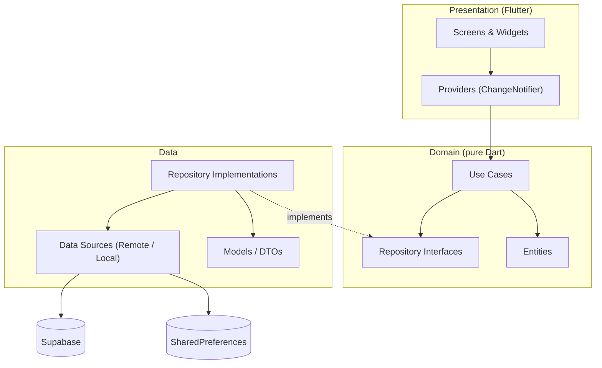
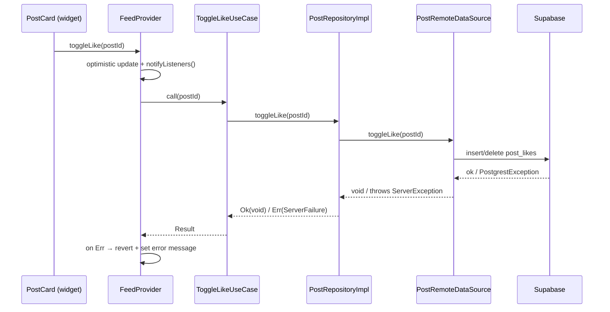
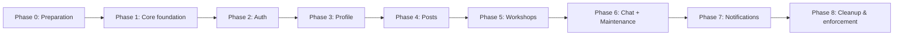

# Shams Mobile App — Clean Architecture Migration Plan

| Item | Value |
|---|---|
| Status | Phase 0 completed — baseline limitations documented |
| Scope | Everything under `lib/` (≈ 70 Dart files, ≈ 20k LOC) |
| Strategy | Incremental, feature by feature (Strangler Fig). No big-bang rewrite. |
| State management | Keep `provider` during the migration. A switch to Bloc/Riverpod is out of scope. |
| Backend | Supabase (`supabase_flutter`), kept as-is |

---

## Table of Contents

1. [Goals & Non-Goals](#1-goals--non-goals)
2. [Current State Audit](#2-current-state-audit)
3. [Target Architecture](#3-target-architecture)
4. [Target Folder Structure](#4-target-folder-structure)
5. [Conventions & Core Building Blocks](#5-conventions--core-building-blocks)
6. [File-by-File Migration Map](#6-file-by-file-migration-map)
7. [Phased Execution Plan](#7-phased-execution-plan)
8. [Reference Implementation: `posts` Feature](#8-reference-implementation-posts-feature)
9. [Testing Strategy](#9-testing-strategy)
10. [Enforcing the Architecture](#10-enforcing-the-architecture)
11. [Known Issues to Fix Along the Way](#11-known-issues-to-fix-along-the-way)
12. [Risks & Mitigations](#12-risks--mitigations)
13. [Effort Estimate](#13-effort-estimate)
14. [Per-Feature Definition of Done](#14-per-feature-definition-of-done)
15. [Open Decisions](#15-open-decisions)

---

## 1. Goals & Non-Goals

### Goals

- **Separation of concerns:** UI, state, business rules and data access each live in their own layer.
- **Dependency rule:** source dependencies only point inward (`presentation → domain ← data`).
- **Testability:** business logic can be unit-tested without Supabase, Flutter or a device.
- **Replaceability:** Supabase, SharedPreferences and storage can be swapped or mocked behind interfaces.
- **Feature isolation:** each feature (auth, posts, workshops, chat, …) is self-contained and easy to navigate.
- **Zero behavior change:** the app must look and behave the same after every phase.

### Non-Goals

- Redesigning the UI.
- Replacing `provider` with another state-management library.
- Changing the Supabase database schema (unless listed in [§11](#11-known-issues-to-fix-along-the-way) and approved separately).
- Adding new features while the migration is in progress.

---

## 2. Current State Audit

### 2.1 Current structure (layer-first)

```text
lib/
├── main.dart
├── models/      (10 files)  data classes with fromSupabase/toMap
├── providers/   (6 files)   ChangeNotifiers, also call Supabase directly
├── services/    (9 files)   static classes wrapping Supabase / SharedPreferences
├── utils/       (2 files)   constants.dart, theme.dart
├── views/       (21 files)  screens, several call Supabase/services directly
└── widgets/     (23 files)  shared and feature-specific widgets mixed together
```

### 2.2 Findings

| # | Finding | Evidence | Impact |
|---|---|---|---|
| F1 | **Screens talk to Supabase directly** | `signin.dart`, `signup.dart`, `signup_profile_screen.dart`, `edit_profile_screen.dart`, `add_workshop_screen.dart`, `notifications_screen.dart` (~L173), `user_profile_screen.dart` (~L838), `shams_drawer.dart` (~L227) | UI coupled to backend; logic duplicated (e.g. sign-out lives in 2 places, avatar upload in 2 places) |
| F2 | **Screens call services directly** | `create_post_screen.dart` → `PostService`, `edit_post_screen.dart` → `PostService`, `workshop_dashboard_screen.dart` → `StorageService` + `WorkshopService` (5 call sites), `chat_conversation_screen.dart` → `ChatService`, `auth_gate.dart` → `LocalStorageService` | Business logic scattered in widgets; hard to test |
| F3 | **Providers depend on Supabase** | Every provider reads `Supabase.instance.client.auth.currentUser`; `user_provider.dart` and `workshop_provider.dart` (~L66, ~L77) run raw queries | Providers can't be tested without a live backend |
| F4 | **Static services with hidden global state** | `PostService`, `ChatService`, `WorkshopService`, `StorageService`, `LocalStorageService` all use `static` + `Supabase.instance.client` | No dependency injection, no mocking |
| F5 | **Models mix domain and persistence** | `post_model.dart` holds fields + `fromSupabase` + `toMap`; services return `Map<String, dynamic>` and providers do the mapping | Supabase JSON shape leaks into presentation |
| F6 | **Presentation formatting inside models** | `PostModel.createdAt` is a formatted string ("منذ يومين"), `viewsCount` is a formatted string ("45.8K") | Domain can't sort/compare dates; formatting can't be localized |
| F7 | **Cross-feature orchestration in a provider** | `ChatProvider` creates a maintenance request → creates a chat → sends a summary message (~L160-L200) | A business workflow is hidden inside UI state |
| F8 | **Two sources of truth for the session** | `AuthGate` uses a SharedPreferences `is_logged_in` flag, while Supabase keeps its own session | Possible "logged in but no session" states |
| F9 | **Leftover wiring** | `ChangeNotifierProxyProvider<WorkshopProvider, FeedProvider>` calls an empty `initializeFromWorkshops()` in `main.dart` | Dead code / extra rebuilds |
| F10 | **Config hardcoded** | Supabase URL and key are literals in `main.dart` | Can't switch environments (dev/staging/prod) |
| F11 | **No errors surfaced to UI** | Most providers `catch` and `debugPrint`, no error/loading state | Users get silent failures |
| F12 | **No tests** | No `test/` folder | No safety net for the refactor |
| F13 | **Very large screens** | `workshop_dashboard_screen.dart` (1193 LOC), `user_profile_screen.dart` (1007), `workshop_profile_screen.dart` (910) | Hard to review; logic and UI tangled |

---

## 3. Target Architecture

### 3.1 Layers



| Layer | Responsibility | May import | Must NOT import |
|---|---|---|---|
| **Domain** | Entities, repository contracts, use cases, business rules | `dart:core`, `dart:async`, `core/error`, `core/usecase`, other features' `domain/entities` | `flutter`, `supabase_flutter`, `shared_preferences`, any `data/` or `presentation/` |
| **Data** | Talk to Supabase / local storage, map JSON ⇄ entities, convert exceptions to failures | `domain/` of the same feature, `core/` | `presentation/`, `flutter/material.dart` |
| **Presentation** | Render UI, hold UI state, call use cases | `domain/` of any feature, `core/` (widgets, theme) | `data/`, `supabase_flutter`, `shared_preferences` |
| **Core** | Cross-cutting infrastructure (errors, DI, config, theme, shared widgets) | anything external | any `features/` |

### 3.2 Request flow example (toggle like)



---

## 4. Target Folder Structure

```text
lib/
├── main.dart                         # bootstrap only: init DI, runApp
├── app/
│   ├── app.dart                      # ShamsApp (MaterialApp, theme, locale)
│   ├── app_providers.dart            # MultiProvider list
│   ├── auth_gate.dart                # moved from widgets/
│   └── main_screen.dart              # bottom-nav shell, moved from views/
│
├── core/
│   ├── config/
│   │   └── env.dart                  # SUPABASE_URL / SUPABASE_ANON_KEY via --dart-define
│   ├── di/
│   │   └── injection.dart            # get_it registrations
│   ├── error/
│   │   ├── exceptions.dart           # ServerException, CacheException, AuthException
│   │   └── failures.dart             # sealed Failure hierarchy
│   ├── result/
│   │   └── result.dart               # sealed Result<T> = Ok | Err
│   ├── usecase/
│   │   └── usecase.dart              # UseCase<T, Params>, NoParams
│   ├── domain/
│   │   └── entities/
│   │       └── app_user.dart         # shared user entity (author, participant, ...)
│   ├── data/
│   │   ├── datasources/
│   │   │   └── file_storage_data_source.dart   # from services/storage_service.dart
│   │   └── models/
│   │       └── app_user_model.dart
│   ├── theme/
│   │   ├── shams_colors.dart         # split from utils/constants.dart
│   │   ├── shams_theme.dart          # from utils/theme.dart
│   │   └── theme_provider.dart       # from providers/theme_provider.dart
│   ├── constants/
│   │   └── app_constants.dart        # cities, service types, brands, ...
│   ├── utils/
│   │   └── formatters.dart           # timeago / compact-number formatting (F6)
│   └── widgets/                      # truly shared, feature-agnostic widgets
│
└── features/
    ├── auth/
    ├── profile/
    ├── posts/
    ├── workshops/
    ├── chat/
    ├── maintenance/
    └── notifications/
```

Each feature follows the same template:

```text
features/<feature>/
├── domain/
│   ├── entities/
│   ├── repositories/          # abstract interface class XRepository
│   └── usecases/              # one class per action
├── data/
│   ├── datasources/           # XRemoteDataSource (+ XLocalDataSource)
│   ├── models/                # XModel: fromJson / toJson / toEntity
│   └── repositories/          # XRepositoryImpl
└── presentation/
    ├── providers/
    ├── screens/
    └── widgets/
```

> **Rule for shared entities:** an entity used by several features (e.g. the post author / chat participant) lives in `core/domain/entities`. A feature may import another feature's `domain/entities` only; never its `data/` or `presentation/`.

---

## 5. Conventions & Core Building Blocks

### 5.1 New dependencies

| Package | Section | Purpose |
|---|---|---|
| `get_it` | dependencies | Service locator / DI container |
| `equatable` *(optional)* | dependencies | Value equality for entities & failures |
| `mocktail` | dev_dependencies | Mocks for unit tests |

No `dartz`/`fpdart`: Dart 3 `sealed` classes are enough for `Result` and keep dependencies minimal.

### 5.2 `Result` and `Failure`

```dart
// core/result/result.dart
import '../error/failures.dart';

sealed class Result<T> {
  const Result();

  R fold<R>(R Function(Failure failure) onErr, R Function(T data) onOk) =>
      switch (this) {
        Ok<T>(:final data) => onOk(data),
        Err<T>(:final failure) => onErr(failure),
      };
}

final class Ok<T> extends Result<T> {
  final T data;
  const Ok(this.data);
}

final class Err<T> extends Result<T> {
  final Failure failure;
  const Err(this.failure);
}
```

```dart
// core/error/failures.dart
sealed class Failure {
  final String message;
  const Failure(this.message);
}

final class ServerFailure extends Failure { const ServerFailure(super.message); }
final class NetworkFailure extends Failure { const NetworkFailure([super.message = 'لا يوجد اتصال بالإنترنت']); }
final class AuthFailure extends Failure { const AuthFailure(super.message); }
final class CacheFailure extends Failure { const CacheFailure(super.message); }
final class NotFoundFailure extends Failure { const NotFoundFailure(super.message); }
final class UnknownFailure extends Failure { const UnknownFailure([super.message = 'حدث خطأ غير متوقع']); }
```

```dart
// core/error/exceptions.dart  (thrown only inside data sources)
class ServerException implements Exception {
  final String message;
  const ServerException(this.message);
}
class CacheException implements Exception {
  final String message;
  const CacheException(this.message);
}
```

**Error flow rule:**
- Data sources **throw** exceptions (`PostgrestException`, `AuthException`, `StorageException` are caught and rethrown as `ServerException`/`AuthException`).
- Repositories **catch** and return `Err(Failure)`. They never throw.
- Use cases return `Result<T>`.
- Providers expose `errorMessage` / status to the UI; they never see Supabase exceptions.

### 5.3 Use case base

```dart
// core/usecase/usecase.dart
import '../result/result.dart';

abstract interface class UseCase<T, Params> {
  Future<Result<T>> call(Params params);
}

abstract interface class StreamUseCase<T, Params> {
  Stream<T> call(Params params);
}

class NoParams {
  const NoParams();
}
```

### 5.4 Provider state convention

Every provider that loads data exposes an explicit status instead of placeholder values like `'جاري التحميل...'`:

```dart
enum ViewStatus { initial, loading, success, failure }

class FeedProvider extends ChangeNotifier {
  ViewStatus status = ViewStatus.initial;
  String? errorMessage;
  ...
}
```

### 5.5 Dependency injection

```dart
// core/di/injection.dart
final sl = GetIt.instance;

Future<void> initDependencies() async {
  // External (Supabase.initialize must be awaited in main() before this)
  sl.registerLazySingleton<SupabaseClient>(() => Supabase.instance.client);
  sl.registerSingleton<SharedPreferences>(await SharedPreferences.getInstance());

  // Core
  sl.registerLazySingleton<FileStorageDataSource>(
      () => FileStorageDataSourceImpl(sl()));

  // Features
  _initAuth();
  _initPosts();
  // ...
}

void _initPosts() {
  sl
    ..registerLazySingleton<PostRemoteDataSource>(
        () => PostRemoteDataSourceImpl(sl(), sl()))
    ..registerLazySingleton<PostRepository>(
        () => PostRepositoryImpl(sl()))
    ..registerLazySingleton(() => GetFeedUseCase(sl(), sl()))
    ..registerLazySingleton(() => ToggleLikeUseCase(sl()));
}
```

> Providers are still created in `MultiProvider`, but receive their use cases from `sl`:
>
> ```dart
> ChangeNotifierProvider(create: (_) => FeedProvider(sl(), sl(), sl())..loadFeed()),
> ```

### 5.6 Naming

| Kind | Pattern | Example |
|---|---|---|
| Entity | `<Name>` (no suffix) | `Post`, `Comment`, `Workshop` |
| Model / DTO | `<Name>Model` | `PostModel` |
| Repository contract | `<Name>Repository` | `PostRepository` |
| Repository impl | `<Name>RepositoryImpl` | `PostRepositoryImpl` |
| Data source | `<Name>RemoteDataSource` / `<Name>LocalDataSource` (+ `Impl`) | `PostRemoteDataSourceImpl` |
| Use case | `<Verb><Noun>UseCase` | `GetFeedUseCase`, `ToggleLikeUseCase` |
| Params | `<UseCase>Params` | `AddCommentParams` |
| Files | `snake_case.dart` matching the class | `get_feed_usecase.dart` |

### 5.7 Configuration

```dart
// core/config/env.dart
class Env {
  static const supabaseUrl = String.fromEnvironment('SUPABASE_URL');
  static const supabaseAnonKey = String.fromEnvironment('SUPABASE_ANON_KEY');
}
```

Run with `flutter run --dart-define-from-file=env/dev.json` (add `env/*.json` to `.gitignore`, commit an `env/example.json`).

---

## 6. File-by-File Migration Map

### 6.1 App shell & core

| Current file | Target | Notes |
|---|---|---|
| `main.dart` | `main.dart` + `app/app.dart` + `app/app_providers.dart` | `main` only initializes Supabase, DI, theme, then `runApp`. Remove `ChangeNotifierProxyProvider` (F9). |
| `views/main_screen.dart` | `app/main_screen.dart` | |
| `widgets/auth_gate.dart` | `app/auth_gate.dart` | Depends on `AuthProvider` instead of `LocalStorageService` (F8). |
| `utils/constants.dart` | `core/theme/shams_colors.dart` + `core/constants/app_constants.dart` | Split colors/theme extension from domain lists (cities, brands). |
| `utils/theme.dart` | `core/theme/shams_theme.dart` | |
| `providers/theme_provider.dart` | `core/theme/theme_provider.dart` | Inject a small `ThemeLocalDataSource` instead of calling `SharedPreferences.getInstance()` inline. |
| `services/supabase_service.dart` | **delete** | Replaced by DI of `SupabaseClient`. |
| `services/storage_service.dart` | `core/data/datasources/file_storage_data_source.dart` | Instance class, injected `SupabaseClient`. |
| `models/user_model.dart` | `core/domain/entities/app_user.dart` + `core/data/models/app_user_model.dart` | Shared by posts, chat, profile. |

### 6.2 Shared widgets → `core/widgets/`

`appbar.dart`, `primary_button.dart`, `outlined_button.dart`, `text_field.dart`, `search_bar.dart`, `inline_search_bar.dart`, `image_source_sheet.dart`, `scrollable_image_picker.dart`, `city_filter.dart`, `shams_bottom_nav_bar.dart`, `shams_drawer.dart`

> `shams_drawer.dart` currently signs out via Supabase directly (F1). It must call `AuthProvider.signOut()` instead.

### 6.3 Features

| Feature | Current files | Target sub-folders |
|---|---|---|
| **auth** | `services/local_storage_service.dart`<br>`views/auth/welcome.dart`, `signin.dart`, `signup.dart`, `signup_profile_screen.dart`<br>`widgets/username_field.dart` | `data/datasources/auth_remote_data_source.dart`, `auth_local_data_source.dart`<br>`presentation/screens/*`<br>`presentation/widgets/username_field.dart` |
| **profile** | `providers/user_provider.dart`<br>`views/user_profile/user_profile_screen.dart`, `edit_profile_screen.dart`, `privacy_security_screen.dart`, `about_shams_screen.dart` | `data/datasources/profile_remote_data_source.dart`<br>`presentation/providers/profile_provider.dart`<br>`presentation/screens/*` |
| **posts** | `models/post_model.dart`, `comment_model.dart`<br>`services/post_service.dart`<br>`providers/feed_provider.dart`<br>`views/home.dart`, `views/posts/post_detail_screen.dart`<br>`views/workshops/create_post_screen.dart`, `edit_post_screen.dart`<br>`widgets/post_card.dart`, `comments_component.dart`, `comment_tile.dart` | `domain/entities/post.dart`, `comment.dart`<br>`data/datasources/post_remote_data_source.dart`<br>`presentation/providers/feed_provider.dart`, `post_editor_provider.dart`<br>`presentation/screens/*`<br>`presentation/widgets/*` |
| **workshops** | `models/public_workshop_model.dart`, `workshop_data.dart`, `review_model.dart`<br>`services/workshop_service.dart`, `review_service.dart`<br>`providers/workshop_provider.dart`<br>`views/workshops/workshops_list_screen.dart`, `workshop_profile_screen.dart`, `workshop_dashboard_screen.dart`<br>`views/user_profile/add_workshop_screen.dart`<br>`widgets/workshop_card.dart`, `managed_post_card.dart` | `domain/entities/workshop.dart`, `review.dart`<br>`domain/usecases/create_workshop_params.dart` (replaces `WorkshopData`, which carries a `File`)<br>`data/datasources/workshop_remote_data_source.dart`, `review_remote_data_source.dart`<br>`presentation/providers/workshops_provider.dart`, `workshop_dashboard_provider.dart` |
| **chat** | `models/chat_model.dart`, `message_model.dart`<br>`services/chat_service.dart`<br>`providers/chat_provider.dart`<br>`views/chat/chat_list_screen.dart`, `chat_conversation_screen.dart`<br>`widgets/chat_tile.dart`, `chat_input_field.dart`, `message_bubble.dart` | `domain/entities/chat.dart`, `message.dart`<br>`data/datasources/chat_remote_data_source.dart` (realtime exposed as `Stream`)<br>`presentation/providers/chat_list_provider.dart`, `conversation_provider.dart` |
| **maintenance** | `models/maintenance_request_model.dart`<br>`services/maintenance_service.dart` | `domain/usecases/submit_maintenance_request_usecase.dart` (orchestrates `MaintenanceRepository` + `ChatRepository`, fixes F7)<br>No screens of its own (triggered from workshop profile / chat) |
| **notifications** | `models/notification_model.dart`<br>`services/notification_service.dart`<br>`providers/notification_provider.dart`<br>`views/notifications/notifications_screen.dart` | `domain/entities/app_notification.dart`<br>`data/datasources/notification_remote_data_source.dart`<br>`presentation/*` |

### 6.4 Use-case inventory (initial)

| Feature | Use cases |
|---|---|
| auth | `SignInWithEmail`, `SignInWithGoogle`, `SignUp`, `SignOut`, `GetCurrentUserId`, `WatchAuthState` |
| profile | `GetMyProfile` (auto-creates default row, see `user_provider.dart`), `UpdateProfile`, `UploadAvatar` |
| posts | `GetFeed`, `GetWorkshopPosts`, `CreatePost`, `UpdatePost`, `DeletePost`, `HidePost`, `ToggleLike`, `GetComments`, `AddComment`, `DeleteComment`, `ToggleCommentLike` |
| workshops | `GetPublicWorkshops`, `GetMyWorkshop`, `GetWorkshopById`, `CreateWorkshop`, `UpdateWorkshop`, `UploadWorkshopImage`, `FollowWorkshop`, `UnfollowWorkshop`, `GetReviews`, `AddReview` |
| chat | `GetChats`, `WatchChatList`, `WatchMessages`, `SendMessage`, `MarkChatAsRead`, `GetOrCreateChat`, `DeleteChats`, `GetChatById` (replaces the direct query in `notifications_screen.dart`) |
| maintenance | `SubmitMaintenanceRequest` |
| notifications | `GetNotifications`, `WatchNotifications`, `MarkAsRead`, `MarkAllAsRead`, `DeleteNotification` |

> Exact method lists must be confirmed against each service while migrating; this table is the starting checklist.

---

## 7. Phased Execution Plan

Each phase lands as **its own branch / PR** and must leave the app buildable and behaving the same.



Auth goes first because **every** provider currently reads `Supabase.instance.client.auth.currentUser`; once `GetCurrentUserId` exists, all later features depend on it instead.

### Inside every feature phase use the same 5 steps

1. **Domain:** create entities, repository interface, use cases. (Pure Dart, compiles on its own.)
2. **Data:** convert the static service into an injected `RemoteDataSource`; create `Model` with `fromJson`/`toEntity`; implement the repository. Old service stays untouched.
3. **Wire:** register in `core/di/injection.dart`.
4. **Switch presentation:** provider receives use cases in its constructor; remove all `Supabase`/`*Service` imports from the provider **and** the feature's screens/widgets; move screens into `features/<f>/presentation/`.
5. **Delete** the old service/model/provider files; run checks; smoke test.

> Use the IDE "move file" refactor (VS Code / Android Studio) so imports are updated automatically. Prefer `package:shams_mobile_app/...` imports over relative ones.

---

### Phase 0 — Preparation

| Task | Detail |
|---|---|
| 0.1 | Create branch `refactor/clean-architecture`. |
| 0.2 | Record baseline: `flutter analyze` output count, app size, a few screenshots. |
| 0.3 | Write a **manual smoke-test checklist** (sign in email/Google, sign up + profile, feed load, like/comment/hide, create/edit post, workshop list/profile/follow, dashboard edits & image upload, add workshop, chat list/conversation realtime, maintenance request, notifications realtime/read/delete, theme toggle, sign out from drawer & profile). |
| 0.4 | Create `test/` folder; add `mocktail` dev dependency; add `get_it`. |
| 0.5 | Agree on [§15 Open Decisions](#15-open-decisions). |

**Done when:** checklist exists, deps added, app runs unchanged.

### Phase 1 — Core foundation

| Task | Detail |
|---|---|
| 1.1 | Add `core/error`, `core/result`, `core/usecase` (see §5). |
| 1.2 | Add `core/config/env.dart`; move Supabase URL/key out of `main.dart` (F10). |
| 1.3 | Add `core/di/injection.dart` with `SupabaseClient` + `SharedPreferences` registrations; call `initDependencies()` from `main`. |
| 1.4 | Split `main.dart` into `app/app.dart` + `app/app_providers.dart`; move `main_screen.dart`. Remove the `ChangeNotifierProxyProvider` + `initializeFromWorkshops` (F9). |
| 1.5 | Move theme/constants into `core/theme` and `core/constants`; inject theme persistence. |
| 1.6 | Convert `StorageService` → `FileStorageDataSource` (keep a thin static shim temporarily if needed by unmigrated screens). |
| 1.7 | Create `AppUser` entity + `AppUserModel`. |
| 1.8 | Move feature-agnostic widgets to `core/widgets/`. |
| 1.9 | Add `core/utils/formatters.dart` (relative time, compact numbers) for F6. |
| 1.10 | Unit tests for `Result`, formatters, `AppUserModel` mapping. |

**Done when:** app runs unchanged, `main.dart` < 30 lines, no business logic in `core/`.

### Phase 2 — Auth

| Task | Detail |
|---|---|
| 2.1 | Domain: `AuthRepository` (`signInWithEmail`, `signInWithGoogle`, `signUp`, `signOut`, `currentUserId`, `authStateChanges`). |
| 2.2 | Data: `AuthRemoteDataSource` (Supabase auth), `AuthLocalDataSource` (from `LocalStorageService`). Map `AuthException` → `AuthFailure` with Arabic user-facing messages. |
| 2.3 | Presentation: new `AuthProvider` (status, error, `signIn`, `signUp`, `signOut`). |
| 2.4 | Remove direct Supabase/`LocalStorageService` usage from `signin.dart`, `signup.dart`, `signup_profile_screen.dart`, `auth_gate.dart`, `shams_drawer.dart`, `user_profile_screen.dart` (sign-out). The `onAuthStateChange` listeners in screens move into `AuthProvider`. |
| 2.5 | Avatar upload during signup goes through `UploadAvatar` (shared with profile, Phase 3) or a temporary repository method. |
| 2.6 | Single sign-out flow: `SignOutUseCase` clears Supabase session, local flag, and notifies other providers to clear their state. |
| 2.7 | Tests: repository impl (success + each failure), `AuthProvider` state transitions. |

**Done when:** no file in `features/auth/presentation`, `app/` or `core/widgets` imports `supabase_flutter`; login/signup/OAuth/sign-out all pass the smoke test.

### Phase 3 — Profile

| Task | Detail |
|---|---|
| 3.1 | Domain: `ProfileRepository` (`getMyProfile`, `updateProfile`, `uploadAvatar`). Move the "auto-create default profile row" rule from `UserProvider.fetchUserData` into `GetMyProfileUseCase` / repository. |
| 3.2 | Data: `ProfileRemoteDataSource` for `profiles` table + avatar bucket. |
| 3.3 | Presentation: rename `UserProvider` → `ProfileProvider`; keep image-cache eviction here (it's a UI concern); replace placeholder names with `ViewStatus`. |
| 3.4 | Remove direct Supabase from `edit_profile_screen.dart`. |
| 3.5 | Tests: default-profile creation logic, email override rule, provider. |

### Phase 4 — Posts (pilot for the full pattern — see [§8](#8-reference-implementation-posts-feature))

| Task | Detail |
|---|---|
| 4.1 | Domain: `Post`, `Comment` entities with `DateTime createdAt` and `int viewsCount` (F6). |
| 4.2 | Data: `PostRemoteDataSource` from `post_service.dart` (instance, injected client + file storage). `PostModel.fromJson` → `toEntity()`. |
| 4.3 | Repository returns entities, not maps. Move "hidden posts filtering" and "liked IDs" merging into the repository/use case instead of the provider. |
| 4.4 | `FeedProvider` uses `GetFeed`, `ToggleLike`, `AddComment`, `DeleteComment`, `ToggleCommentLike`, `HidePost`. |
| 4.5 | `create_post_screen.dart` / `edit_post_screen.dart` use a `PostEditorProvider` (or use cases via an existing provider) instead of `PostService`. |
| 4.6 | Widgets format dates/numbers through `core/utils/formatters.dart`. |
| 4.7 | Tests: use cases, repository mapping, optimistic like revert in provider. |

### Phase 5 — Workshops (+ reviews)

| Task | Detail |
|---|---|
| 5.1 | Domain: `Workshop`, `Review` entities; `WorkshopRepository`, `ReviewRepository`; `CreateWorkshopParams` (replace `WorkshopData`; image passed as `String path` or bytes, not `File`, to keep domain free of `dart:io` if desired). |
| 5.2 | Data: from `workshop_service.dart`, `review_service.dart`, plus the raw queries in `workshop_provider.dart` (~L66, ~L77). |
| 5.3 | Split `WorkshopProvider` into `WorkshopsProvider` (public list, follow) and `WorkshopDashboardProvider` (my workshop editing). Workshop posts reuse `GetWorkshopPostsUseCase` from **posts**. |
| 5.4 | Remove `StorageService`/`WorkshopService` calls from `workshop_dashboard_screen.dart` (5 call sites) and `add_workshop_screen.dart`. |
| 5.5 | Break `workshop_dashboard_screen.dart` and `workshop_profile_screen.dart` into smaller widgets under `presentation/widgets/` (F13). |
| 5.6 | After creating a workshop, `ProfileProvider.updateWorkshopStatus` is still triggered from presentation (or via a domain event); document the choice. |
| 5.7 | Tests. |

### Phase 6 — Chat + Maintenance

| Task | Detail |
|---|---|
| 6.1 | Domain: `Chat`, `Message`, `MaintenanceRequest`; `ChatRepository` with `Stream`-based `watchMessages(chatId)` and `watchChatList(chatIds)`. |
| 6.2 | Data: `ChatRemoteDataSource` wraps Supabase realtime channels into `Stream`s (close channel on `onCancel`). `MaintenanceRemoteDataSource` from `maintenance_service.dart`. |
| 6.3 | `SubmitMaintenanceRequestUseCase(MaintenanceRepository, ChatRepository)`: create request → get/create chat → send summary message. Removes the workflow from `ChatProvider` (F7). |
| 6.4 | Split `ChatProvider` into `ChatListProvider` and `ConversationProvider`; `chat_conversation_screen.dart` stops calling `ChatService.subscribeToMessages` directly. |
| 6.5 | Tests: use-case orchestration (order of calls, failure in the middle), stream mapping. |

### Phase 7 — Notifications

| Task | Detail |
|---|---|
| 7.1 | Domain/Data from `notification_model.dart` + `notification_service.dart`; realtime as `Stream`. |
| 7.2 | `notifications_screen.dart` (~L173) uses `GetChatByIdUseCase` from **chat** instead of querying Supabase. |
| 7.3 | Tests. |

### Phase 8 — Cleanup & enforcement

| Task | Detail |
|---|---|
| 8.1 | Delete empty `models/`, `providers/`, `services/`, `utils/`, `views/`, `widgets/`. |
| 8.2 | Add the architecture check script and lints from [§10](#10-enforcing-the-architecture); run it in CI (or a pre-commit hook). |
| 8.3 | Run full smoke test + `flutter analyze` (0 new warnings) + `flutter test`. |
| 8.4 | Update `README.md` with the new structure and a "how to add a feature" guide. |

---

## 8. Reference Implementation: `posts` Feature

This is the template every other feature copies. Code is illustrative; field lists must match the real tables.

### 8.1 Domain

```dart
// features/posts/domain/entities/post.dart
import 'package:shams_mobile_app/core/domain/entities/app_user.dart';
import 'comment.dart';

class Post {
  final String id;
  final String? workshopId;
  final String textDetails;
  final List<String> images;
  final int viewsCount;          // was a formatted String
  final DateTime createdAt;      // was a formatted String
  final bool isHighlighted;
  final AppUser? author;
  final int likesCount;
  final bool isLiked;
  final List<Comment> comments;

  const Post({
    required this.id,
    this.workshopId,
    required this.textDetails,
    this.images = const [],
    this.viewsCount = 0,
    required this.createdAt,
    this.isHighlighted = false,
    this.author,
    this.likesCount = 0,
    this.isLiked = false,
    this.comments = const [],
  });

  Post copyWith({bool? isLiked, int? likesCount, List<Comment>? comments}) => Post(
        id: id,
        workshopId: workshopId,
        textDetails: textDetails,
        images: images,
        viewsCount: viewsCount,
        createdAt: createdAt,
        isHighlighted: isHighlighted,
        author: author,
        likesCount: likesCount ?? this.likesCount,
        isLiked: isLiked ?? this.isLiked,
        comments: comments ?? this.comments,
      );
}
```

```dart
// features/posts/domain/repositories/post_repository.dart
abstract interface class PostRepository {
  Future<Result<List<Post>>> getFeed({required String userId, int limit = 20, int offset = 0});
  Future<Result<void>> toggleLike(String postId);
  Future<Result<Comment>> addComment({required String postId, required String text});
  Future<Result<void>> hidePost(String postId);
  // ...
}
```

```dart
// features/posts/domain/usecases/get_feed_usecase.dart
class GetFeedUseCase implements UseCase<List<Post>, GetFeedParams> {
  final PostRepository _posts;
  final AuthRepository _auth;
  const GetFeedUseCase(this._posts, this._auth);

  @override
  Future<Result<List<Post>>> call(GetFeedParams params) async {
    final userId = _auth.currentUserId;
    if (userId == null) return const Err(AuthFailure('يجب تسجيل الدخول'));
    return _posts.getFeed(userId: userId, limit: params.limit, offset: params.offset);
  }
}

class GetFeedParams {
  final int limit;
  final int offset;
  const GetFeedParams({this.limit = 20, this.offset = 0});
}
```

### 8.2 Data

```dart
// features/posts/data/datasources/post_remote_data_source.dart
abstract interface class PostRemoteDataSource {
  Future<List<Map<String, dynamic>>> fetchFeed({required String userId, required int limit, required int offset});
  Future<Set<String>> fetchLikedPostIds(List<String> postIds);
  Future<void> toggleLike(String postId);
  // ...
}

class PostRemoteDataSourceImpl implements PostRemoteDataSource {
  final SupabaseClient _db;
  final FileStorageDataSource _storage;
  PostRemoteDataSourceImpl(this._db, this._storage);

  @override
  Future<List<Map<String, dynamic>>> fetchFeed({
    required String userId,
    required int limit,
    required int offset,
  }) async {
    try {
      // body moved from PostService.fetchFeed, using _db instead of the static client
      ...
    } on PostgrestException catch (e) {
      throw ServerException(e.message);
    }
  }
}
```

```dart
// features/posts/data/models/post_model.dart
class PostModel {
  static Post fromJson(
    Map<String, dynamic> json, {
    required bool isLiked,
    List<Comment> comments = const [],
  }) =>
      Post(
        id: json['id'] as String,
        workshopId: json['workshop_id'] as String?,
        textDetails: json['text_details'] as String? ?? '',
        images: List<String>.from(json['images'] ?? const []),
        viewsCount: json['views_count'] as int? ?? 0,
        createdAt: DateTime.parse(json['created_at'] as String),
        isHighlighted: json['is_highlighted'] as bool? ?? false,
        author: json['profiles'] == null ? null : AppUserModel.fromJson(json['profiles']),
        likesCount: json['likes_count'] as int? ?? 0,
        isLiked: isLiked,
        comments: comments,
      );
}
```

```dart
// features/posts/data/repositories/post_repository_impl.dart
class PostRepositoryImpl implements PostRepository {
  final PostRemoteDataSource _remote;
  const PostRepositoryImpl(this._remote);

  @override
  Future<Result<List<Post>>> getFeed({required String userId, int limit = 20, int offset = 0}) async {
    try {
      final rows = await _remote.fetchFeed(userId: userId, limit: limit, offset: offset);
      final ids = rows.map((r) => r['id'] as String).toList();
      final liked = ids.isEmpty ? <String>{} : await _remote.fetchLikedPostIds(ids);
      return Ok(rows.map((r) => PostModel.fromJson(r, isLiked: liked.contains(r['id']))).toList());
    } on ServerException catch (e) {
      return Err(ServerFailure(e.message));
    } catch (_) {
      return const Err(UnknownFailure());
    }
  }
}
```

### 8.3 Presentation

```dart
// features/posts/presentation/providers/feed_provider.dart
class FeedProvider extends ChangeNotifier {
  final GetFeedUseCase _getFeed;
  final ToggleLikeUseCase _toggleLike;
  FeedProvider(this._getFeed, this._toggleLike);

  List<Post> _posts = [];
  List<Post> get posts => List.unmodifiable(_posts);
  ViewStatus status = ViewStatus.initial;
  String? errorMessage;

  Future<void> loadFeed() async {
    status = ViewStatus.loading;
    notifyListeners();
    final result = await _getFeed(const GetFeedParams());
    result.fold(
      (f) { status = ViewStatus.failure; errorMessage = f.message; },
      (data) { status = ViewStatus.success; _posts = data; },
    );
    notifyListeners();
  }

  Future<void> toggleLike(String postId) async {
    final i = _posts.indexWhere((p) => p.id == postId);
    if (i == -1) return;
    final old = _posts[i];
    _posts[i] = old.copyWith(
      isLiked: !old.isLiked,
      likesCount: old.likesCount + (old.isLiked ? -1 : 1),
    );
    notifyListeners();
    final result = await _toggleLike(postId);
    if (result case Err(:final failure)) {
      _posts[i] = old; // revert
      errorMessage = failure.message;
      notifyListeners();
    }
  }
}
```

Notice: **no** `supabase_flutter`, **no** `PostService`, **no** `Map<String, dynamic>` in the provider.

---

## 9. Testing Strategy

| Layer | What to test | Tools | Target |
|---|---|---|---|
| Domain (use cases) | Rules & orchestration (e.g. `SubmitMaintenanceRequest` call order, `GetFeed` without user → `AuthFailure`) | `test`, `mocktail` | ~100% of use cases |
| Data (models) | JSON ⇄ entity mapping, null/missing fields | `test` | All models |
| Data (repositories) | Success path; each exception → correct `Failure` | `mocktail` (mock data sources) | All public methods |
| Presentation (providers) | Status transitions, optimistic update + revert, error messages | `mocktail` (mock use cases) | Critical providers (auth, feed, chat) |
| Widgets | Key screens render loading/error/success | `flutter_test` | Optional, after migration |
| Data sources | Not unit-tested (thin Supabase wrappers); covered by manual smoke test | — | — |

Folder layout mirrors `lib/`:

```text
test/
├── core/
└── features/
    └── posts/
        ├── domain/usecases/get_feed_usecase_test.dart
        ├── data/models/post_model_test.dart
        ├── data/repositories/post_repository_impl_test.dart
        └── presentation/providers/feed_provider_test.dart
```

---

## 10. Enforcing the Architecture

### 10.1 Import-rule check script

Add `tool/check_architecture.dart` and run `dart run tool/check_architecture.dart` in CI / pre-commit:

```dart
import 'dart:io';

final rules = <RegExp, List<String>>{
  RegExp(r'lib[\\/]features[\\/][^\\/]+[\\/]domain[\\/]'): [
    'package:flutter/', 'package:supabase_flutter/', 'package:shared_preferences/', '/data/', '/presentation/',
  ],
  RegExp(r'lib[\\/]features[\\/][^\\/]+[\\/]presentation[\\/]'): [
    'package:supabase_flutter/', 'package:shared_preferences/', '/data/',
  ],
  RegExp(r'lib[\\/]features[\\/][^\\/]+[\\/]data[\\/]'): ['/presentation/'],
  RegExp(r'lib[\\/]core[\\/]'): ['/features/'],
};

void main() {
  var violations = 0;
  for (final file in Directory('lib').listSync(recursive: true).whereType<File>()) {
    if (!file.path.endsWith('.dart')) continue;
    for (final entry in rules.entries) {
      if (!entry.key.hasMatch(file.path)) continue;
      final lines = file.readAsLinesSync();
      for (var i = 0; i < lines.length; i++) {
        final line = lines[i].trim();
        if (!line.startsWith('import ')) continue;
        for (final banned in entry.value) {
          if (line.contains(banned)) {
            stdout.writeln('${file.path}:${i + 1}  forbidden import "$banned"');
            violations++;
          }
        }
      }
    }
  }
  if (violations > 0) exit(1);
  stdout.writeln('Architecture check passed.');
}
```

> `core/di/injection.dart` is the only place allowed to import all layers; exclude it from the `core` rule.

### 10.2 Lints (`analysis_options.yaml`)

```yaml
linter:
  rules:
    - always_use_package_imports
    - avoid_print
    - prefer_final_fields
    - require_trailing_commas
```

### 10.3 PR checklist

- [ ] No `supabase_flutter` / `shared_preferences` import outside `data/` and `core/di`, `main.dart`
- [ ] No `Map<String, dynamic>` crossing from data into presentation
- [ ] New logic has a use case + test
- [ ] `flutter analyze` and `dart run tool/check_architecture.dart` pass

---

## 11. Known Issues to Fix Along the Way

These are **not** architecture changes, but the refactor makes them easy to fix. Each should be a separate commit and may need team approval.

| # | Issue | Where | Suggested fix |
|---|---|---|---|
| K1 | N+1 queries: comments fetched per post in a loop | `FeedProvider.fetchFeed`, `WorkshopProvider` (~L110) | Fetch comments lazily on post detail, or one batched query `in('post_id', ids)` |
| K2 | View counter does read-then-write per post (race condition) | `PostService._incrementPostsViews` | Postgres RPC `increment_views(post_ids uuid[])` |
| K3 | Session duplicated in SharedPreferences | `LocalStorageService`, `AuthGate` | Use Supabase session as the source of truth (see §15) |
| K4 | Silent failures (`debugPrint` only) | All providers | Expose `errorMessage` and show a SnackBar |
| K5 | `print` in production code | `post_service.dart` | `debugPrint` or a logger |
| K6 | Providers start loading in constructors | `FeedProvider()`, `ChatProvider()` | Call `load()` explicitly after auth is ready (avoids fetching before login) |
| K7 | Provider state not cleared on sign-out (except user) | chat, feed, notifications, workshops | `SignOut` flow resets all providers |

---

## 12. Risks & Mitigations

| Risk | Probability | Impact | Mitigation |
|---|---|---|---|
| Regressions from moving files | Medium | High | One feature per PR, IDE refactors, smoke checklist after each phase |
| Realtime subscriptions leak or duplicate after converting to `Stream` | Medium | Medium | Close channels in `StreamController.onCancel`; cancel subscriptions in `dispose()`; test by navigating in/out of chat |
| Merge conflicts with ongoing feature work | High | Medium | Freeze features during a phase, or rebase daily; keep phases short |
| Over-engineering (too many tiny classes) | Medium | Low | Use cases only for real actions; skip a use case only if it is a 1:1 pass-through *and* the team agrees |
| Date/number formatting changes alter UI text | Low | Low | Formatters reproduce current output exactly; compare screenshots |
| Large screens hide logic that is missed | Medium | Medium | Grep each screen for `await` and `Supabase`/`Service` before marking the phase done |

---

## 13. Effort Estimate

Rough, for one developer familiar with the codebase:

| Phase | Size | Estimate |
|---|---|---|
| 0. Preparation | S | 0.5 day |
| 1. Core foundation | M | 1.5–2 days |
| 2. Auth | M | 1.5 days |
| 3. Profile | S | 1 day |
| 4. Posts | L | 2–3 days |
| 5. Workshops (+ splitting large screens) | L | 3 days |
| 6. Chat + Maintenance | L | 2–3 days |
| 7. Notifications | S | 1 day |
| 8. Cleanup & enforcement | S | 1 day |
| **Total** | | **≈ 14–17 working days** |

---

## 14. Per-Feature Definition of Done

- [ ] `domain/` contains entities, repository interface, use cases — no Flutter/Supabase imports
- [ ] `data/` contains data source(s), models, repository impl; all exceptions mapped to `Failure`
- [ ] Dependencies registered in `core/di/injection.dart`
- [ ] Provider depends only on use cases; exposes `status` + `errorMessage`
- [ ] Screens/widgets moved under `features/<f>/presentation/` and import no `data/`, `supabase_flutter`, or services
- [ ] Old model/service/provider files deleted
- [ ] Unit tests for use cases, model mapping, repository, provider
- [ ] `flutter analyze` clean (no new issues), `flutter test` green, architecture check green
- [ ] Manual smoke-test items for this feature pass on a real device

---

## 15. Open Decisions

| # | Question | Options | Recommendation |
|---|---|---|---|
| D1 | DI approach | `get_it` / pass everything through `MultiProvider` / `injectable` codegen | `get_it` without codegen (simple, explicit) |
| D2 | Session source of truth | Keep SharedPreferences flag / Use Supabase session only | Supabase session only; keep local storage just for non-auth prefs |
| D3 | Error type | Custom sealed `Result` / `fpdart` `Either` | Custom sealed `Result` (no extra dependency) |
| D4 | Domain may use `dart:io` `File`? | Allow / use `String path` or `Uint8List` | Use `String path` in params; data layer creates the `File` |
| D5 | Shared user entity location | `core/domain/entities` / separate `shared` feature | `core/domain/entities/app_user.dart` |
| D6 | Fix known issues (§11) during migration? | Yes, separate commits / Defer to after migration | K4, K6, K7 during migration (they touch the same code); K1, K2 after |
| D7 | Future state-management switch | Stay on `provider` / Move to Bloc or Riverpod later | Stay on `provider` now; the new layers make a later switch cheap |
