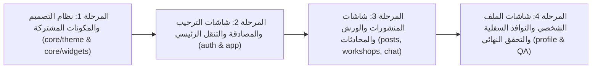

# 🎨 خطة تحليل وتحسين واجهات وتجربة المستخدم (UI/UX Improvement Plan) — تطبيق شمس (`shams_mobile_app`)

> **تاريخ إعداد الخطة:** 2026-11-23  
> **المرجعية البصرية:** 22 لقطة شاشة حية ملتقطة عبر `adb` من جهاز أندرويد حقيقي (`720×1612`) محفوظة في [`docs/screenshots/`](../screenshots/)  
> **المعايير المرجعية:** نظام تصميم شمس (`ShamsTheme` & `ShamsExtendedColors`)، إرشادات WCAG 2.1 AA للتباين والوصول، ومبادئ Nielsen Heuristics & Fitts's/Hick's Laws  
> **القيود المعمارية:** الالتزام الصارم بقواعد `tool/check_architecture.dart` (عزل الطبقات، استخدام `AppLocalizations`، ودعم الاتجاهين RTL/LTR عبر `EdgeInsetsDirectional` و`AlignmentDirectional`).

---

## 📊 1. ملخص الفجوات البصرية العامة (Cross-Cutting Design System Issues)

قبل التفصيل لكل شاشة على حدة، كشف الفحص البصري للقطات الشاشة (`01` إلى `22`) ومراجعة ملفات الثيم ([`shams_colors.dart`](../../lib/core/theme/shams_colors.dart) و[`shams_theme.dart`](../../lib/core/theme/shams_theme.dart)) عن **6 مشكلات تصميمية مشتركة** تؤثر على هوية التطبيق ككل:

| # | المشكلة المشتركة | الشاشات المتأثرة | السبب البرمجي المباشر | الحل الموصى به في نظام التصميم |
|---|---|---|---|---|
| **G1** | **ضعف حاد في تباين الأزرار والروابط الصفراء على الخلفية الفاتحة (نسبة التباين `1.6:1` فقط — أقل من حد WCAG AA البالغ `4.5:1`)** | `14`، `20`، `21`، `22` | استخدام اللون الأصفر الشمسي `colorScheme.secondary` (`#FFC53D`) كلون نص وحدود في [`CustomOutlinedButton`](../../lib/core/widgets/outlined_button.dart) وروابط شاشات المصادقة والخصوصية على خلفية بيضاء `#FFFFFF` أو `#F5F7FF`. | اعتماد `colorScheme.primary` (`#0052CC` في الوضع الفاتح و`#6BA3FF` في الوضع الداكن) للأزرار المفرغة (`CustomOutlinedButton`) والروابط النصية القابلة للنقر، وحصر اللون الأصفر `#FFC53D` كخلفية ممتلئة مع نص داكن (`onSecondary: #1E2430`). |
| **G2** | **تضارب ألوان وتصميم الشريط العلوي (`AppBar`) بين الشاشات** | `01`، `05`، `07`، `08`، `11`، `13`، `14`، `18` | • [`ChatListScreen`](../../lib/features/chat/presentation/screens/chat_list_screen.dart) يستخدم `backgroundColor: colorScheme.primary` (`#0052CC`) دون تعيين لون النص، فيظهر العنوان `"Chats"` باللون الرمادي الداكن `#4A4A4A` فوق الأزرق الداكن (تباين `1.7:1` شبه غير مقروء!).<br>• [`PostDetailScreen`](../../lib/features/posts/presentation/screens/post_detail_screen.dart) يستخدم خلفية صفراء فاقعة `colorScheme.secondary`.<br>• باقي الشاشات الفرعية تستخدم `colorScheme.surface` مع أيقونات رجوع غير موحدة (`arrow_back_rounded` مقابل `arrow_back_ios_new_rounded`). | توحيد الشريط العلوي في جميع الشاشات الرئيسية الأربعة عبر `ShamsPlatformAppBar` (أو شريط موحد بخلفية `colorScheme.surface` وحد سفلي `ext.dividerLight`)، وتوحيد جميع الشاشات الفرعية لتستخدم `AppBar` قياسياً من `ShamsTheme.appBarTheme` مع `Icons.arrow_back_rounded`. |
| **G3** | **اختفاء أيقونات شريط الحالة للنظام (`System Status Bar`)** | `12`، `18`، `20`، `21`، `22` | عدم ضبط `SystemUiOverlayStyle` في `AppBarTheme` وعند فتح شاشات الترحيب والمصادقة، مما يجعل أيقونات الساعة والبطارية والشبكة بيضاء فوق خلفية فاتحة `#F5F7FF`. | إضافة `systemOverlayStyle` ديناميكي داخل `ShamsTheme.light.appBarTheme` (`SystemUiOverlayStyle.dark`) و`ShamsTheme.dark.appBarTheme` (`SystemUiOverlayStyle.light`) وتغليف الشاشات التي لا تحتوي على `AppBar` بـ `AnnotatedRegion<SystemUiOverlayStyle>`. |
| **G4** | **بقاء شريط التنقل السفلي ظاهراً أسفل القائمة الجانبية المفتوحة (`Drawer`)** | `02` | تعريف `drawer: ShamsDrawer(...)` داخل الـ `Scaffold` الفرعي لـ `HomeScreen` و`WorkshopsListScreen` بدلاً من الـ `Scaffold` الأب في [`MainScreen`](../../lib/app/main_screen.dart). | نقل `ShamsDrawer` أو فتحه عبر `Scaffold` الرئيسي في [`MainScreen`](../../lib/app/main_screen.dart) ليغطي الشاشة بالكامل من الأعلى إلى الأسفل شاملةً `ShamsBottomNavBar`. |
| **G5** | **عدم تطابق تسمية وأيقونة التبويب الثالث في الشريط السفلي مع وظيفته الفعلية** | `01`، `07`، `11`، `12` | التبويب الثالث في [`ShamsBottomNavBar`](../../lib/core/widgets/shams_bottom_nav_bar.dart) يحمل أيقونة `Icons.people_alt_rounded` وتسمية `"Following"` (`followNav`)، بينما يفتح فعلياً شاشة المحادثات [`ChatListScreen`](../../lib/features/chat/presentation/screens/chat_list_screen.dart) (`"Chats"`). | تحديث الأيقونة في `ShamsBottomNavBar.defaultItems[2]` إلى `Icons.chat_bubble_rounded` / `Icons.chat_bubble_outline_rounded` وربط التسمية بمفتاح الترجمة `myChats` / `chatsTitle` مع دعم شارة الرسائل غير المقروءة. |
| **G6** | **تفاوت تصميم أزرار الإجراءات الأساسية (`Primary CTA`) في النوافذ السفلية (`Bottom Sheets`)** | `04`، `09`، `10`، `15`، `16`، `19` | نافذة التقييم (`09`) تستخدم زراً أزرق (`#0052CC`) مع زر `"Cancel"` نصي جانبي، بينما نافذة طلب الصيانة (`10`) ونافذة اللغة (`15`) تستخدمان زراً أصفر (`#FFC53D`) بعرض كامل، وتسجيل الخروج يمتلك تصميمين مختلفين (Dialog في القائمة الجانبية مقابل BottomSheet في الملف الشخصي). | إنشاء مكوّن موحد للنوافذ السفلية `ShamsBottomSheetContainer` يتضمن مقبض سحب (`handleBar`)، ترويسة موحدة مع زر إغلاق `IconButton(Icons.close_rounded)`، وتخطيط أزرار موحد في الأسفل. |

---

## 📱 2. التحليل التفصيلي وخطة التحسين لكل شاشة (Screen-by-Screen Audit & Plan)

### 2.1 الشاشة الرئيسية والمنشورات (Home Feed, Dark Mode, Post Detail & Comments)
**اللقطات المرجعية:**  
- [`01_home_feed_screen.png`](../screenshots/01_home_feed_screen.png)  
- [`04_post_comments_sheet.png`](../screenshots/04_post_comments_sheet.png)  
- [`05_post_detail_screen.png`](../screenshots/05_post_detail_screen.png)  
- [`06_home_feed_dark_mode.png`](../screenshots/06_home_feed_dark_mode.png)  

**الملفات البرمجية:**  
- [`lib/core/widgets/appbar.dart`](../../lib/core/widgets/appbar.dart)  
- [`lib/features/posts/presentation/screens/home_screen.dart`](../../lib/features/posts/presentation/screens/home_screen.dart)  
- [`lib/features/posts/presentation/widgets/post_card.dart`](../../lib/features/posts/presentation/widgets/post_card.dart)  
- [`lib/features/posts/presentation/screens/post_detail_screen.dart`](../../lib/features/posts/presentation/screens/post_detail_screen.dart)  
- [`lib/features/posts/presentation/widgets/comments_component.dart`](../../lib/features/posts/presentation/widgets/comments_component.dart)  

#### 🔍 الملاحظات البصرية:
1. **انزياح شعار `Shams` في `ShamsPlatformAppBar` (`01`، `06`):** الشعار ليس في منتصف الشاشة تماماً لأن الطرف الأيمن يحتوي على أيقونتين (`Dark Mode` + `Notifications`) بعرض إجمالي ~70dp بينما الطرف الأيسر يحتوي على أيقونة واحدة (`Menu`) بعرض 28dp داخل `Row`.
2. **غياب التوقيت الزمني وزر المشاركة في `PostCard` (`01`، `05`، `06`):** ترويسة المنشور تعرض الاسم والمعرّف (`@gjggjj`) دون وقت النشر (مثل `"منذ ساعتين"` أو `"2h ago"`)، كما أن شريط التفاعل السفلي يعرض أيقونتي التعليق والإعجاب في طرف البطاقة ويترك أكثر من 70% من عرض الشريط فارغاً مع غياب زر المشاركة وغياب حواف/تبطين للصورة (`_buildImageCarousel` لا يضيف `horizontal: 14` padding، فتلتصق الصورة بحواف البطاقة بينما النص والترويسة لهما تبطين `14dp`).
3. **شريط العنوان الأصفر في `PostDetailScreen` (`05`):** الخلفية الصفراء الكاملة للشريط العلوي مع المربع الرمادي الداكن حول سهم الرجوع تبدو غريبة عن بقية شاشات التطبيق وتصرف الانتباه عن محتوى المنشور.
4. **شريط إدخال التعليق في `04_post_comments_sheet.png`:** حقل الكتابة الرمادي بيضاوي الشكل (`borderRadius: 24`) وبجانبه زر إرسال أزرق مربع الحواف (`borderRadius: 14`) بارتفاع أكبر من الحقل، مما يخلق عدم اتساق هندسي، كما أن الحالة الفارغة للتعليقات باهتة جداً.

#### 🛠️ خطة التحسين:
- **`ShamsPlatformAppBar` ([`appbar.dart`](../../lib/core/widgets/appbar.dart)):** استخدام `Stack` أو موازنة عرض الحاويتين الجانبيتين (`SizedBox(width: 72)`) لضمان تمركز شعار `Shams` هندسياً في منتصف الشاشة تماماً، وإضافة خط فاصل سفلي ناعم `Border(bottom: BorderSide(color: ext.dividerLight))`.
- **`PostCard` ([`post_card.dart`](../../lib/features/posts/presentation/widgets/post_card.dart)):**
  - إضافة خاصية اختيارية `createdAt` أو `timeAgoText` في ترويسة البطاقة بجانب المعرّف (`@handle • 2h`).
  - إضافة `padding: const EdgeInsets.symmetric(horizontal: 14)` حول `_buildImageCarousel` لتتطابق محاذاة الصورة مع النص والترويسة.
  - إضافة زر المشاركة (`Icons.share_outlined`) في الطرف المقابل لشريط التفاعلات السفلي مع تحسين مساحة اللمس (`minHeight: 40dp` وفق قانون Fitts).
  - إضافة إطار خفيف للبطاقة في الوضع الداكن (`border: Border.all(color: ext.borderLight, width: 0.8)`) لزيادة بروز البطاقات في `06_home_feed_dark_mode.png`.
- **`PostDetailScreen` ([`post_detail_screen.dart`](../../lib/features/posts/presentation/screens/post_detail_screen.dart)):** استبدال `_buildAppBar` الأصفر المخصص بـ `AppBar` قياسي بخلفية `colorScheme.surface`، عنوان في المنتصف، وأيقونة مشاركة نظيفة في `actions`، مع تثبيت شريط كتابة تعليق سريع في أسفل الشاشة (`bottomNavigationBar`) بدلاً من إجبار المستخدم على فتح نافذة منبثقة للتعليق.
- **`CommentsComponent` ([`comments_component.dart`](../../lib/features/posts/presentation/widgets/comments_component.dart)):** توحيد ارتفاع ونصف قطر حقل الإدخال وزر الإرسال (`48dp` ارتفاع، `borderRadius: 24` أو دمج زر الإرسال داخل `suffixIcon` للحقل النصي).

---

### 2.2 القائمة الجانبية وشاشة الإشعارات (Navigation Drawer & Notifications)
**اللقطات المرجعية:**  
- [`02_navigation_drawer.png`](../screenshots/02_navigation_drawer.png)  
- [`03_notifications_screen.png`](../screenshots/03_notifications_screen.png)  

**الملفات البرمجية:**  
- [`lib/core/widgets/shams_drawer.dart`](../../lib/core/widgets/shams_drawer.dart)  
- [`lib/app/main_screen.dart`](../../lib/app/main_screen.dart)  
- [`lib/features/notifications/presentation/screens/notifications_screen.dart`](../../lib/features/notifications/presentation/screens/notifications_screen.dart)  

#### 🔍 الملاحظات البصرية:
1. **تداخل القائمة الجانبية مع الشريط السفلي (`02`):** شريط التنقل السفلي يظهر أسفل القائمة الجانبية المفتوحة.
2. **تدرج ترويسة القائمة الجانبية (`02`):** التدرج ينتهي باللون الفاتح `colorScheme.primaryContainer` (`#D6E4FF`) في الزاوية التي يقع فيها البريد الإلكتروني الأبيض الشفاف (`4nis.dev@gmail.com`)، مما يضعف قراءته.
3. **تكرار عناصر القائمة الجانبية (`02`):** عنصرا `"My Chats"` و`"My Maintenance Requests"` يؤديان إلى نفس الوجهة (`_navigateTo(context, 2)`) دون تمييز، كما تفتقر القائمة إلى مقسمات مجموعات واضحة (التنقل الأساسي مقابل الحساب والدعم).
4. **شاشة الإشعارات الفارغة (`03`):** مساحة بيضاء شاسعة مع أيقونة رمادية باهتة جداً دون حاوية دائرية ملونة أو زر تحديث/تصفح.

#### 🛠️ خطة التحسين:
- **`ShamsDrawer` ([`shams_drawer.dart`](../../lib/core/widgets/shams_drawer.dart)):**
  - تعديل تدرج الترويسة ليستخدم درجتين داكنتين متناسقتين من الأزرق (`Color(0xFF003D99)` إلى `Color(0xFF0052CC)`) مع شارة `"Shams Client"` بخلفية نصف شفافة وإطار ناعم، لضمان تباين عالٍ (`> 7:1`) لاسم المستخدم والبريد الإلكتروني.
  - إضافة قسميْ عناوين فرعية خفيفة أو خط فاصل `Divider` يفصل بين عناصر التنقل (`Home`, `Workshops`, `My Chats`) وعناصر الحساب والدعم (`Edit My Profile`, `About Shams Platform`, `Technical Support`).
- **`NotificationsScreen` ([`notifications_screen.dart`](../../lib/features/notifications/presentation/screens/notifications_screen.dart)):**
  - وضع أيقونة الحالة الفارغة داخل دائرة ناعمة (`width: 88, height: 88, color: colorScheme.primaryContainer.withValues(alpha: 0.35)`) بلون `colorScheme.primary` مع رفع تباين النص الفرعي إلى `colorScheme.onSurfaceVariant`.

---

### 2.3 قائمة الورش، ملف الورشة، التقييمات، وطلب الصيانة (Workshops & Maintenance Flow)
**اللقطات المرجعية:**  
- [`07_workshops_list_screen.png`](../screenshots/07_workshops_list_screen.png)  
- [`08_workshop_profile_screen.png`](../screenshots/08_workshop_profile_screen.png)  
- [`09_workshop_add_review_sheet.png`](../screenshots/09_workshop_add_review_sheet.png)  
- [`10_maintenance_request_sheet.png`](../screenshots/10_maintenance_request_sheet.png)  
- [`13_add_workshop_screen.png`](../screenshots/13_add_workshop_screen.png)  

**الملفات البرمجية:**  
- [`lib/features/workshops/presentation/screens/workshops_list_screen.dart`](../../lib/features/workshops/presentation/screens/workshops_list_screen.dart)  
- [`lib/features/workshops/presentation/widgets/workshop_card.dart`](../../lib/features/workshops/presentation/widgets/workshop_card.dart)  
- [`lib/core/widgets/city_filter.dart`](../../lib/core/widgets/city_filter.dart)  
- [`lib/features/workshops/presentation/screens/workshop_profile_screen.dart`](../../lib/features/workshops/presentation/screens/workshop_profile_screen.dart)  
- [`lib/features/workshops/presentation/widgets/profile/review_editor_sheet.dart`](../../lib/features/workshops/presentation/widgets/profile/review_editor_sheet.dart)  
- [`lib/features/workshops/presentation/widgets/profile/maintenance_request_sheet.dart`](../../lib/features/workshops/presentation/widgets/profile/maintenance_request_sheet.dart)  
- [`lib/features/workshops/presentation/screens/add_workshop_screen.dart`](../../lib/features/workshops/presentation/screens/add_workshop_screen.dart)  

#### 🔍 الملاحظات البصرية:
1. **فلاتر الخدمات في `WorkshopsListScreen` (`07`):** شرائح تصفية الخدمات (`"New System Installation"`, `"Solar Panel Maintenance"`) تظهر كنصوص عائمة بلا خلفية ولا إطار (`border`) في حالتها غير المحددة، مما يجعلها تبدو كعناوين نصية مقطوعة عند طرف الشاشة وليست أزرار تصفية قابلة للنقر!
2. **تساوي الوزن البصري لزريْ `"Follow"` و`"View Workshop"` في `WorkshopCard` (`07`):** كلا الزرين يستخدمان خلفية صفراء مصمتة (`isPrimary: true`) بنفس الحجم واللون، مما يشتت المستخدم عن الإجراء الأساسي للبطاقة (`"View Workshop"`). كما أن معرّف الورشة `message` يظهر بدون علامة `@`.
3. **تصادم زر `"Request Maintenance Now"` العائم مع محتوى `WorkshopProfile` (`08`):** الزر العائم (`floatingActionButton`) يغطي مباشرة عنوان قسم `"Work Log"` والتاريخ `"1 days ago"` بدون شريط خلفية سفلي يفصله عن المحتوى المتحرّك تحته.
4. **عدم توازن صف التواصل والمتابعة في `WorkshopProfile` (`08`):** زر `"Follow"` ضخم جداً مقارنة بالدوائر الثلاث الصغيرة بجانبه، وأيقونة الاتصال السوداء لن تظهر بوضوح في الوضع الداكن.
5. **نافذة إضافة التقييم (`09`):** زر `"Publish Review"` أزرق اللون بينما زر `"Cancel"` نصي منزوٍ في الطرف، على عكس بقية نوافذ التطبيق.
6. **نافذة طلب الصيانة (`10`):** الحقول الخمسة تفتقر إلى عناوين فوق الحقول (`Labels`) أو أيقونات دلالية (`prefixIcon`)، فعند اختيار قيمة من القائمة المنسدلة يختفي النص التوضيحي (`Hint`) ولا يعرف المستخدم ما الذي يمثله الحقل.
7. **شاشة إضافة ورشة (`13`):** دائرة `"Photo"` المتداخلة مع الغلاف تستخدم نصاً أصفر باهتاً فوق خلفية بيضاء، وحقلا `"Years of Experience"` و`"Governorate *"` المتجاوران غير متساويين في الارتفاع البصري (`TextField` مقابل `DropdownButtonFormField`).

#### 🛠️ خطة التحسين:
- **`WorkshopsListScreen` ([`workshops_list_screen.dart`](../../lib/features/workshops/presentation/screens/workshops_list_screen.dart)):**
  - إحاطة شرائح الخدمات (`Service Chips`) غير المحددة بإطار واضح `Border.all(color: ext.borderLight, width: 1.2)` وخلفية `ext.chipBackground` مع `borderRadius: BorderRadius.circular(20)`، ودمج زر تصفية المحافظات (`CityMultiSelectFilter`) في صف الفلاتر العلوي لتوفير المساحة الرأسية.
- **`WorkshopCard` ([`workshop_card.dart`](../../lib/features/workshops/presentation/widgets/workshop_card.dart)):**
  - جعل زر `"View Workshop"` هو الزر الأساسي المصمت الوحيد (`colorScheme.secondary` أو `colorScheme.primary`)، وتحويل زر `"Follow"` إلى زر ثانوي مفرغ (`Outlined` بإطار `colorScheme.primary` ونص `colorScheme.primary`، وعند المتابعة يتحول إلى شارة هادئة مع أيقونة `Icons.check_rounded`).
  - ضمان سبق معرّف الورشة (`userHandle`) بعلامة `@` دائماً عند العرض.
- **`WorkshopProfile` ([`workshop_profile_screen.dart`](../../lib/features/workshops/presentation/screens/workshop_profile_screen.dart)):**
  - نقل زر `"Request Maintenance Now"` من `floatingActionButton` عائم فوق النص إلى `bottomNavigationBar` ثابت داخل `Container` بخلفية `colorScheme.surface` وظل علوي ناعم + `SafeArea` (تماماً مثل `WorkshopDashboardScreen`).
- **`ReviewEditorSheet` ([`review_editor_sheet.dart`](../../lib/features/workshops/presentation/widgets/profile/review_editor_sheet.dart)):**
  - توحيد أزرار الإجراءات السفلية لتكون زرين متجاورين متناسقين (`Expanded` لكل زر، أو زر `CustomSolidButton` أساسي وزر `OutlinedButton` للإلغاء).
- **`MaintenanceRequestSheet` ([`maintenance_request_sheet.dart`](../../lib/features/workshops/presentation/widgets/profile/maintenance_request_sheet.dart)):**
  - إضافة عناوين حقول واضحة (`_buildFieldLabel`) أو `prefixIcon` دلالية لكل حقل (`Icons.build_circle_outlined` لنوع الخدمة، `Icons.electrical_services_rounded` للإنفرتر، `Icons.battery_charging_full_rounded` للبطارية، `Icons.bolt_rounded` للسعة، `Icons.description_outlined` لتفاصيل المشكلة).
- **`AddWorkshopScreen` ([`add_workshop_screen.dart`](../../lib/features/workshops/presentation/screens/add_workshop_screen.dart)):**
  - توحيد `contentPadding` بين حقل `"Years of Experience"` وقائمة `"Governorate *"` المنسدلة ليتطابق ارتفاعهما (`52dp`)، واستبدال النص الأصفر الباهت `"Photo"` في دائرة الشعار بـ `colorScheme.primary` أو `colorScheme.onSurfaceVariant`.

---

### 2.4 شاشة المحادثات (Chats List Screen)
**اللقطة المرجعية:**  
- [`11_chats_list_screen.png`](../screenshots/11_chats_list_screen.png)  

**الملفات البرمجية:**  
- [`lib/features/chat/presentation/screens/chat_list_screen.dart`](../../lib/features/chat/presentation/screens/chat_list_screen.dart)  
- [`lib/core/widgets/shams_bottom_nav_bar.dart`](../../lib/core/widgets/shams_bottom_nav_bar.dart)  

#### 🔍 الملاحظات البصرية:
1. **انعدام مقروئية عنوان `"Chats"` في الشريط العلوي (`11`):** النص مرسوم باللون الرمادي الداكن `#4A4A4A` فوق خلفية زرقاء داكنة `#0052CC`!
2. **شذوذ الشريط العلوي عن بقية تبويبات الشاشة الرئيسية (`11`):** التبويبان الأول والثاني يستخدمان `ShamsPlatformAppBar` الأبيض النظيف، بينما التبويب الثالث يستخدم `AppBar` أزرق مصمتاً بلا أيقونة قائمة جانبية ولا زر وضع ليلي ولا إشعارات.
3. **الحالة الفارغة للمحادثات (`11`):** الأيقونة باهتة جداً ولا يوجد زر يوجه المستخدم إلى تصفح الورش لبدء محادثة أو طلب صيانة.

#### 🛠️ خطة التحسين:
- **`ChatListScreen` ([`chat_list_screen.dart`](../../lib/features/chat/presentation/screens/chat_list_screen.dart)):**
  - استبدال الـ `AppBar` الأزرق الشاذ بـ `ShamsPlatformAppBar` (أو `AppBar` بخلفية `colorScheme.surface` ونص `colorScheme.onSurface` مع خط فاصل سفلي `ext.dividerLight`) ليتناغم بصرياً مع تبويبات `MainScreen`.
  - تحسين الحالة الفارغة بإضافة حاوية أيقونة دائرية ملونة وزر إجراء واضح (`"Browse Workshops"` / `"تصفح الورش"`) ينقل المستخدم إلى تبويب الورش.
- **`ShamsBottomNavBar` ([`shams_bottom_nav_bar.dart`](../../lib/core/widgets/shams_bottom_nav_bar.dart)):**
  - تحديث أيقونة وتسمية التبويب الثالث من `"Following"` إلى `"Chats"` (`l10n.myChats` / `l10n.chatsTitle`) مع أيقونة `Icons.chat_bubble_outline_rounded` / `Icons.chat_bubble_rounded`.

---

### 2.5 الملف الشخصي، الإعدادات، النوافذ السفلية، وتعديل الملف (Profile & Settings Suite)
**اللقطات المرجعية:**  
- [`12_user_profile_screen.png`](../screenshots/12_user_profile_screen.png)  
- [`14_privacy_security_screen.png`](../screenshots/14_privacy_security_screen.png)  
- [`15_language_selection_sheet.png`](../screenshots/15_language_selection_sheet.png)  
- [`16_contact_support_sheet.png`](../screenshots/16_contact_support_sheet.png)  
- [`17_about_shams_screen.png`](../screenshots/17_about_shams_screen.png)  
- [`18_edit_profile_screen.png`](../screenshots/18_edit_profile_screen.png)  
- [`19_logout_confirmation_sheet.jpeg`](../screenshots/19_logout_confirmation_sheet.jpeg)  

**الملفات البرمجية:**  
- [`lib/features/profile/presentation/screens/user_profile_screen.dart`](../../lib/features/profile/presentation/screens/user_profile_screen.dart)  
- [`lib/features/profile/presentation/widgets/profile_header_card.dart`](../../lib/features/profile/presentation/widgets/profile_header_card.dart)  
- [`lib/features/profile/presentation/widgets/profile_bottom_sheets.dart`](../../lib/features/profile/presentation/widgets/profile_bottom_sheets.dart)  
- [`lib/features/profile/presentation/screens/edit_profile_screen.dart`](../../lib/features/profile/presentation/screens/edit_profile_screen.dart)  
- [`lib/features/profile/presentation/screens/privacy_security_screen.dart`](../../lib/features/profile/presentation/screens/privacy_security_screen.dart)  
- [`lib/features/profile/presentation/screens/about_shams_screen.dart`](../../lib/features/profile/presentation/screens/about_shams_screen.dart)  

#### 🔍 الملاحظات البصرية:
1. **أيقونة الموقع اليتيمةوزر `"Edit Profile"` الباهت في `UserProfileScreen` (`12`):**
   - أسفل `@4nis.dev` تظهر أيقونة دبوس موقع صفراء صغيرة (`Icons.location_on`) بدون أي نص بجانبها لأن موقع المستخدم فارغ!
   - زر `"Edit Profile"` في أعلى اليمين يستخدم نصاً وأيقونة وحدوداً باللون الأصفر `#FFC53D` فوق خلفية رمادية فاتحة `#F5F7FF`، مما يجعله باهتاً وضعيف التباين.
2. **التمرير تحت شريط الحالة (`18`):** عند التمرير لأسفل في `UserProfileScreen`، يدخل المحتوى مباشرة تحت شريط حالة النظام بدون `SafeArea` علوية أو `SliverAppBar`، وتختفي أيقونات الساعة والبطارية.
3. **شاشة الخصوصية والأمان (`14`):** رابط `"Full Privacy Policy"` في أسفل الشاشة مكتوب باللون الأصفر `#FFC53D` فوق خلفية بيضاء بدون أيقونة رابط خارجي أو إطار زر، فيبدو شبه مختفٍ.
4. **نافذة اختيار اللغة (`15`):** تستخدم مربعات اختيار متعددة (`Checkbox`) لخيار حصري فردي (إما العربية أو الإنجليزية)، بينما المعيار القياسي في HCI هو استخدام أزرار راديو (`Radio`) أو دائرة اختيار (`Icons.check_circle_rounded`).
5. **نافذة الدعم الفني (`16`):** العناصر الثلاثة (`WhatsApp`, `Phone Call`, `Email`) معروضة كصفوف عادية بلا بطاقات حاوية ولا نصوص فرعية توضح رقم الهاتف أو البريد الإلكتروني ولا سهم انتقال.
6. **شاشة نبذة عن شمس (`17`):** المربعات الثلاثة في الأسفل (`Easy Access`, `Sustainability`, `Direct Workshop`) تقتطع النص الثالث (`Direct Workshop`) بسبب ضيق المساحة الأفقية وعدم السماح بسطرين متمركزين بارتفاع متساوٍ.
7. **شاشة تعديل الملف الشخصي (`EditProfileScreen`):** لا تحتوي على حقل اختيار المحافظة/الموقع (`_selectedLocation` معرّف في الكود ص 25 و40 لكنه غير معروض في واجهة المستخدم!)، وأيقونة الكاميرا تستخدم `Colors.white` فوق خلفية صفراء `#FFC53D` (تباين ضعيف مقارنة بـ `colorScheme.onSecondary`).

#### 🛠️ خطة التحسين:
- **`ProfileHeaderCard` ([`profile_header_card.dart`](../../lib/features/profile/presentation/widgets/profile_header_card.dart)):**
  - إخفاء صف الموقع (`Row` الخاص بـ `Icons.location_on`) بالكامل إذا كان `currentUser.location` فارغاً أو `null` (أو عرض نص احتياطي `"حدد موقعك"` قابل للنقر).
  - تغيير لون نص وأيقونة وحدود زر `"Edit Profile"` إلى `colorScheme.primary` مع خلفية `colorScheme.surface` لرفع التباين والوضوح.
- **`EditProfileScreen` ([`edit_profile_screen.dart`](../../lib/features/profile/presentation/screens/edit_profile_screen.dart)):**
  - إضافة قائمة منسدلة لاختيار المحافظة (`DropdownButtonFormField` مربوطة بـ `_selectedLocation` و`ShamsConstants.yemeniCities`) حتى يتمكن المستخدم من تعديل موقعه فعلياً.
  - تغيير لون أيقونة الكاميرا فوق الدائرة الصفراء من `Colors.white` إلى `colorScheme.onSecondary`.
- **`ProfileBottomSheets` ([`profile_bottom_sheets.dart`](../../lib/features/profile/presentation/widgets/profile_bottom_sheets.dart)):**
  - استبدال `Checkbox` في نافذة اللغة بـ `Icons.check_circle_rounded` / `Icons.radio_button_unchecked_rounded` مع تلوين إطار الخيار المحدد بـ `colorScheme.primary`.
  - تحويل خيارات الدعم الفني (`WhatsApp`, `Phone Call`, `Email`) إلى بطاقات تفاعلية ذات خلفية `ext.backgroundLight` مع عرض الرقم/البريد كـ `subtitle` وأيقونة سهم اتجاهي `Icons.arrow_forward_ios_rounded` في الطرف.
- **`PrivacySecurityScreen` ([`privacy_security_screen.dart`](../../lib/features/profile/presentation/screens/privacy_security_screen.dart)):**
  - تحويل رابط `"Full Privacy Policy"` إلى `OutlinedButton.icon` بلون `colorScheme.primary` مع أيقونة `Icons.open_in_new_rounded`.
- **`AboutShamsScreen` ([`about_shams_screen.dart`](../../lib/features/profile/presentation/screens/about_shams_screen.dart)):**
  - وضع الميزات الثلاث داخل بطاقات متساوية العرض (`Expanded`) مع السماح بسطرين (`maxLines: 2`, `textAlign: TextAlign.center`) لمنع اقتطاع `"Direct Workshop"`.

---

### 2.6 شاشات الترحيب والمصادقة (Welcome, Sign Up & Sign In Screens)
**اللقطات المرجعية:**  
- [`20_welcome_screen.jpeg`](../screenshots/20_welcome_screen.jpeg)  
- [`21_signup_screen.jpeg`](../screenshots/21_signup_screen.jpeg)  
- [`22_signin_screen.jpeg`](../screenshots/22_signin_screen.jpeg)  

**الملفات البرمجية:**  
- [`lib/features/auth/presentation/screens/welcome.dart`](../../lib/features/auth/presentation/screens/welcome.dart)  
- [`lib/features/auth/presentation/screens/signup.dart`](../../lib/features/auth/presentation/screens/signup.dart)  
- [`lib/features/auth/presentation/screens/signin.dart`](../../lib/features/auth/presentation/screens/signin.dart)  
- [`lib/core/widgets/outlined_button.dart`](../../lib/core/widgets/outlined_button.dart)  

#### 🔍 الملاحظات البصرية:
1. **ضعف شديد في وضوح الأزرار المفرغة (`"Sign In"`, `"Google"`, `"Sign in with Google"`) والروابط السفلية (`20`، `21`، `22`):**
   - بسبب استخدام اللون الأصفر `#FFC53D` للنص والحدود فوق خلفية بيضاء/فاتحة، تكاد نصوص `"Sign In"` في `20_welcome_screen.jpeg` و`"Google"` في `21_signup_screen.jpeg` و`"Sign in with Google"` في `22_signin_screen.jpeg` أن تتلاشى بصرياً.
2. **وضع زر Google خارج البطاقة في `SignInScreen` (`22`) وداخل البطاقة في `SignUpScreen` (`21`):**
   - في `21_signup_screen.jpeg` يقع فاصل `"Or create an account with"` وزر `"Google"` **داخل** البطاقة البيضاء، بينما في `22_signin_screen.jpeg` يقع زر `"Sign in with Google"` **خارج** البطاقة البيضاء بدون فاصل `"Or"`، مما يخلق عدم اتساق بصري واضح بين شاشتي الدخول والتسجيل.
3. **عنوان `"Shams"` ونص الشعار في `WelcomeScreen` (`20`):**
   - عنوان `"Shams"` يستخدم `colorScheme.secondary` (`#FFC53D`) فوق خلفية فاتحة `#F5F7FF`، ونص الشروط في الأسفل يستخدم اللون الثابت `Color(0xFFBFC3CE)` الذي يصعب قراءته تماماً ولا يتكيف مع الوضع الداكن.

#### 🛠️ خطة التحسين:
- **`CustomOutlinedButton` ([`outlined_button.dart`](../../lib/core/widgets/outlined_button.dart)):**
  - تحديث اللون الافتراضي للنص والحدود من `colorScheme.secondary` إلى `colorScheme.primary` (مع خلفية شفافة أو `colorScheme.surface`) لرفع نسبة التباين من `1.6:1` إلى **`7.4:1`** (متوافق مع WCAG AAA).
- **`WelcomeScreen` ([`welcome.dart`](../../lib/features/auth/presentation/screens/welcome.dart)):**
  - تغيير لون عنوان `"Shams"` الرئيسي إلى `colorScheme.primary` (أو `colorScheme.onSurface`) ليتطابق مع الهوية الزرقاء الداكنة في الشعار، واستبدال اللون الثابت `Color(0xFFBFC3CE)` في نص شروط الخدمة بـ `colorScheme.onSurfaceVariant`.
- **`SignInScreen` & `SignUpScreen` ([`signin.dart`](../../lib/features/auth/presentation/screens/signin.dart) & [`signup.dart`](../../lib/features/auth/presentation/screens/signup.dart)):**
  - توحيد هيكل البطاقة البيضاء في الشاشتين بحيث يتضمن كلاهما فاصل `"أو"` (`Divider` + نص وسطي) وزر `"Google"` داخل البطاقة البيضاء نفسها.
  - تغيير لون روابط الانتقال السفلية (`"Sign In"` و`"Join us now"`) من `colorScheme.secondary` إلى `colorScheme.primary` بخط عريض (`FontWeight.w700`).

---

## 🗺️ 3. خارطة طريق التنفيذ المرحلية (Phased Implementation Roadmap)

لتنفيذ هذه التحسينات بأمان ودون كسر أي اختبار أو قاعدة معمارية في `tool/check_architecture.dart`، تُقسّم الخطة إلى **4 مراحل متسلسلة (Waves)**:



### المرحلة 1: ترقية نظام التصميم والمكونات المشتركة (`lib/core/`)
- [ ] **`lib/core/theme/shams_theme.dart`**: ضبط `systemOverlayStyle` في `AppBarTheme` للوضعين الفاتح والداكن لحل مشكلة اختفاء شريط الحالة (`G3`).
- [ ] **`lib/core/widgets/outlined_button.dart`**: تحديث `CustomOutlinedButton` ليستخدم `colorScheme.primary` بدلاً من `colorScheme.secondary` (`G1`).
- [ ] **`lib/core/widgets/appbar.dart`**: موازنة عرض العناصر الجانبية في `ShamsPlatformAppBar` لتمركز الشعار بدقة وإضافة حد سفلي `ext.dividerLight`.
- [ ] **`lib/core/widgets/shams_bottom_nav_bar.dart`**: تحديث أيقونة وتسمية التبويب الثالث ليعكس شاشة المحادثات (`Chats`) بدلاً من `Following` (`G5`).
- [ ] **`lib/core/widgets/shams_drawer.dart`**: تحسين تباين تدرج الترويسة وتنظيم عناصر القائمة الجانبية مع فواصل منطقية.

### المرحلة 2: تحسين شاشات المصادقة والهيكل الرئيسي (`lib/app/` & `lib/features/auth/`)
- [ ] **`lib/app/main_screen.dart`**: ربط القائمة الجانبية `ShamsDrawer` بمستوى `MainScreen` عند الحاجة أو توحيد سلوكها عبر التبويبات (`G4`).
- [ ] **`lib/features/auth/presentation/screens/welcome.dart`**: تحسين تباين عنوان التطبيق، بطاقات المميزات، ونص شروط الخدمة.
- [ ] **`lib/features/auth/presentation/screens/signin.dart` & `signup.dart`**: توحيد موضع زر Google وفاصل `"Or"` داخل البطاقة، وتحويل الروابط التفاعلية إلى `colorScheme.primary`.

### المرحلة 3: تحسين شاشات المنشورات، الورش، والمحادثات (`lib/features/posts/`, `workshops/`, `chat/`)
- [ ] **`lib/features/posts/presentation/widgets/post_card.dart`**: محاذاة حواف الصورة مع النص (`horizontal: 14`)، إضافة زر المشاركة في الشريط السفلي، وإطار البطاقة في الوضع الداكن.
- [ ] **`lib/features/posts/presentation/screens/post_detail_screen.dart` & `widgets/comments_component.dart`**: توحيد `AppBar` مع بقية الشاشات الفرعية (`colorScheme.surface`) وموازنة شريط كتابة التعليق.
- [ ] **`lib/features/workshops/presentation/screens/workshops_list_screen.dart` & `widgets/workshop_card.dart`**: إبراز شرائح تصفية الخدمات بإطار وخلفية واضحة، والتمييز البصري بين زر `"Follow"` (ثانوي مفرغ) وزر `"View Workshop"` (أساسي مصمت).
- [ ] **`lib/features/workshops/presentation/screens/workshop_profile_screen.dart`**: نقل زر `"Request Maintenance Now"` إلى `bottomNavigationBar` ثابت لمنع تغطية قسم `"Work Log"`.
- [ ] **`lib/features/workshops/presentation/widgets/profile/maintenance_request_sheet.dart` & `review_editor_sheet.dart` & `screens/add_workshop_screen.dart`**: إضافة الأيقونات الدلالية لحقول الصيانة، توحيد أزرار نافذة التقييم، ومساواة ارتفاع حقلي الخبرة والمحافظة.
- [ ] **`lib/features/chat/presentation/screens/chat_list_screen.dart`**: إصلاح تباين عنوان `AppBar` وتوحيده مع الشاشات الرئيسية + تحسين الحالة الفارغة.

### المرحلة 4: تحسين شاشات الملف الشخصي والإعدادات وبوابات التحقق (`lib/features/profile/` & `notifications/`)
- [ ] **`lib/features/profile/presentation/widgets/profile_header_card.dart`**: إخفاء أيقونة الموقع عندما يكون الموقع فارغاً، وتحسين تباين زر `"Edit Profile"`.
- [ ] **`lib/features/profile/presentation/screens/edit_profile_screen.dart`**: إضافة حقل اختيار المحافظة وتصحيح لون أيقونة الكاميرا.
- [ ] **`lib/features/profile/presentation/widgets/profile_bottom_sheets.dart`**: استبدال `Checkbox` بدوائر اختيار فردية في نافذة اللغة، وتحويل خيارات الدعم الفني إلى بطاقات واضحة.
- [ ] **`lib/features/profile/presentation/screens/privacy_security_screen.dart` & `about_shams_screen.dart`**: تحسين زر سياسة الخصوصية الكاملة ومنع اقتطاع عناوين الميزات الثلاث.
- [ ] **`lib/features/notifications/presentation/screens/notifications_screen.dart`**: تحسين تصميم الحالة الفارغة للإشعارات.

---

## ✅ 4. بوابات التحقق والاختبار بعد كل مرحلة (Verification Gates)

بعد تنفيذ أي مرحلة من المراحل أعلاه، يجب تشغيل أوامر التحقق القياسية لضمان عدم وجود أي كسر معماري أو تحذير:

```powershell
flutter pub get
dart run tool/check_architecture.dart
flutter analyze
flutter test
flutter build apk --debug --dart-define-from-file=env/dev.json
```

